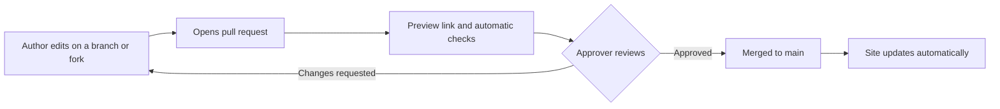

# Review and approval

## What happens to a change

## Who approves what

| Change | Approval needed |
| --- | --- |
| A **policy** | The authority named in that policy, for example the Board of Directors or the Executive Team. The pull request records the approval, and the approval is also minuted in the usual way. |
| A new or changed **SOP** | [TBC: per the Delegation of Authority] |
| A typo, formatting fix, or broken link | A site maintainer |
| The site itself (configuration, navigation, workflow) | A site maintainer |

## Rules

- Authors cannot approve their own change.
- Approvers check for accuracy, clarity, correct roles, no invented thresholds, an updated version number and revision history, and a completed [Before you publish](/contributing/before-you-publish) checklist.
- An SOP with any `[TBC]` left in it cannot be approved.
- Use **Squash and merge**, so each change shows as one entry in the history.

## Version numbering

| Change | Example |
| --- | --- |
| Typo, formatting, or small clarification | 1.0 to 1.1 |
| Change to steps, roles, or requirements | 1.1 to 2.0 |
| Draft not yet approved | 0.1, 0.2, and so on |

## Retiring a document

Do not delete it quietly. Change its status to **Retired**, note the reason in the revision history, and update the library page. The history in GitHub keeps every earlier version.
