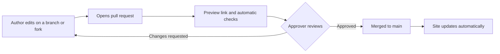

# Review and approval

## What happens to a change

## Rules

- Every SOP change needs **at least one approval** from the SOP owner or a named approver.
- Authors cannot approve their own change.
- Approvers check for accuracy, clarity, correct roles, an updated version number, an updated revision history, and a completed [Before you publish](/contributing/before-you-publish) checklist.
- Use **Squash and merge**, so each change shows as one entry in the history.

## Version numbering

| Change | Example |
| --- | --- |
| Typo, formatting, or small clarification | 1.0 to 1.1 |
| Change to steps, roles, or requirements | 1.1 to 2.0 |

## Retiring an SOP

Do not delete it quietly. Change its status to **Retired** in the document control table, note the reason in the revision history, and update the SOP Library table. The history in GitHub keeps every earlier version.
