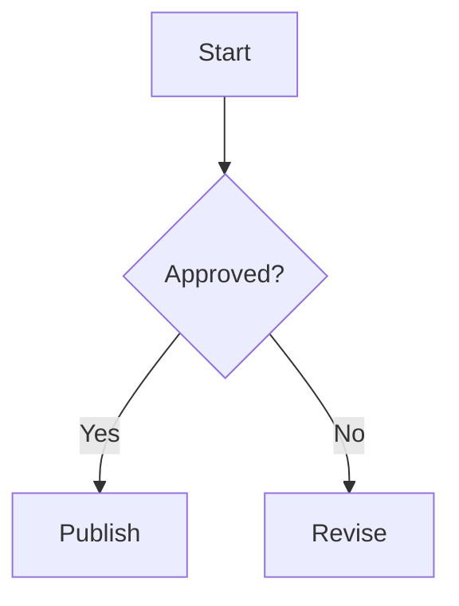

# Markdown Test

> [!WARNING]
>
> **PLACEHOLDER PAGE.** Used to check which Markdown features render. Delete before go-live.

## Table

| Column A | Column B |
| -------- | -------- |
| One      | Two      |

## Numbered list

1. First
2. Second
3. Third

## Image

## Callouts

> [!NOTE]
>
> Useful information.

> [!TIP]
>
> Helpful advice.

> [!IMPORTANT]
>
> Key information.

> [!WARNING]
>
> Urgent information.

> [!CAUTION]
>
> Risks or negative outcomes.

## Mermaid

