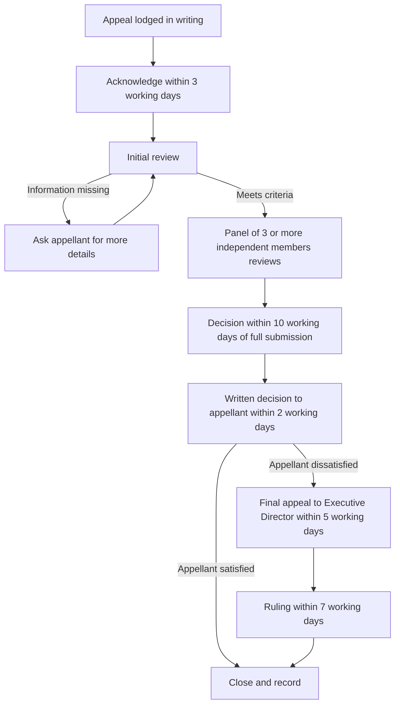

# SOP-TRN-005: Appeals Handling

| Field | Detail |
| --- | --- |
| **SOP code** | SOP-TRN-005 |
| **Department** | Training and Quality Assurance |
| **Process owner** | Appeals Committee (administrator role: [TBC]) |
| **Approved by** | [TBC: per the Delegation of Authority] |
| **Version** | 0.1 (Draft) |
| **Review cycle** | Annually, or when the Appeals Policy or regulations change |
| **Related policy** | [Appeals Policy](/policies/appeals-policy) |

> [!IMPORTANT]
>
> This SOP is a draft prepared from the approved policy. Every item marked [TBC] must be completed by the process owner before the SOP is approved.

## 1. Purpose and scope

This SOP explains how GRIT Hub receives, reviews, decides, and records appeals. It covers appeals about assessments, certifications, disciplinary actions, and administrative decisions, as set out in the [Appeals Policy](/policies/appeals-policy).

## 2. Roles and responsibilities

| Role | Responsibility |
| --- | --- |
| **Appellant** | Lodges the appeal in writing, with the required information and evidence. |
| **Appeals Committee** | Acknowledges, reviews, and decides appeals. A panel of at least three independent members reviews each appeal. |
| **Appeals administrator** | [TBC: role that receives appeals, keeps the register, and tracks deadlines] |
| **Executive Director** | Reviews and rules on final appeals. The ruling is final and binding. |

## 3. Step-by-step operating procedure

1. **Receive the appeal.** Appeals go to the Appeals Committee through [TBC: the designated channel and address]. Record the date received in the appeals register.
2. **Check the appeal is in time.** It must be in writing and lodged within **7 working days** of the date the decision was communicated. Record the dates.
3. **Check the content.** The appeal must include the appellant's full name and contact details, a detailed explanation of the issue and the grounds, supporting evidence (if any), and the outcome the appellant wants. See the checklist at the end of this SOP.
4. **Acknowledge in writing** within **3 working days** of receiving the appeal.
5. **Do the initial review.** Decide whether the appeal falls within the grounds: assessment, certification, disciplinary, or administrative. [TBC: deadline for the initial review]. If information is missing, ask the appellant for it and record the date you asked. The 10-day review period starts when the full submission is received.
6. **Appoint the panel.** Appoint at least **three independent members** who were not involved in the original decision. Each member declares any conflict of interest before the review starts (see section 5.1 of the [Governance and Finance Policy](/policies/governance-and-finance-policy)). [TBC: how independence is checked and who appoints the panel]
7. **Review the appeal.** The panel may interview the appellant and other relevant people, review assessment records, policies, and the evidence submitted, and seek expert opinions where needed. Complete the review within **10 working days** of receiving the full submission.
8. **Decide.** The decision is one of: appeal upheld, appeal denied, or decision modified.
9. **Write the decision.** The written decision states the outcome, the reasons for it, and any further action required.
10. **Tell the appellant** in writing within **2 working days** after the review is concluded.
11. **Carry out any action** the decision requires. [TBC: who does it and by when, for example re-marking or reissuing a certificate]
12. **Handle a final appeal.** If the appellant is dissatisfied, they may appeal to the Executive Director within **5 working days** of receiving the decision. The Executive Director reviews independently and gives a final ruling within **7 working days**. The ruling is final and binding.
13. **Close the appeal.** Record the outcome and file the records securely. Keep proceedings confidential. Nobody may be treated unfairly or punished for lodging an appeal.

### Timeline summary

| Stage | Who | Deadline |
| --- | --- | --- |
| Lodge the appeal | Appellant | 7 working days from the date the decision was communicated |
| Acknowledge receipt | Appeals Committee | 3 working days from receipt |
| Complete the panel review | Appeals Committee | 10 working days from receiving the full submission |
| Communicate the decision | Appeals Committee | 2 working days after the review is concluded |
| Lodge a final appeal | Appellant | 5 working days from receiving the decision |
| Final ruling | Executive Director | 7 working days from the final appeal |

## 4. Required forms, records and evidence

| Record | Kept by | Retention |
| --- | --- | --- |
| Appeals register (dates received, acknowledged, decided, communicated) | [TBC] | [TBC] |
| Appeal submission and evidence | [TBC] | [TBC] |
| Panel appointment and conflict-of-interest declarations | [TBC] | [TBC] |
| Interview notes and records reviewed | [TBC] | [TBC] |
| Written decision and any final ruling | [TBC] | [TBC] |

Appeal records contain personal information. Store and dispose of them as set out in the [POPIA Policy](/policies/popia-policy).

## 5. Quality checks and approval points

- Every deadline in the timeline summary is tracked in the register.
- Each panel has at least three members, all independent of the original decision.
- Every written decision gives reasons.
- [TBC: how often the appeals register is reviewed, and by whom]

## 6. Exceptions and escalation

| Situation | What to do |
| --- | --- |
| The appeal is late | [TBC: who decides whether to accept it, and on what grounds] |
| The appeal is incomplete | Ask the appellant for the missing information. The review period starts when the full submission is received. |
| A panel member has a conflict of interest | They step down and are replaced. Record the declaration. |
| The Executive Director was involved in the original decision | [TBC: who rules on the final appeal] |

## 7. Related policies and regulatory requirements

- [Appeals Policy](/policies/appeals-policy)
- [Assessment Policy](/policies/assessment-policy)
- [Certification Policy](/policies/certification-policy)
- [POPIA Policy](/policies/popia-policy)

## 8. Document control and revision history

| Version | Date | Author | Summary of change |
| --- | --- | --- | --- |
| 0.1 | YYYY-MM-DD | [TBC] | Draft prepared from the Appeals Policy |

## Appendix: appeal submission checklist

- [ ] Full name and contact details
- [ ] The decision being appealed, and the date it was communicated
- [ ] The ground: assessment, certification, disciplinary, or administrative
- [ ] A detailed explanation of the issue
- [ ] Supporting evidence, if any
- [ ] The outcome the appellant wants
