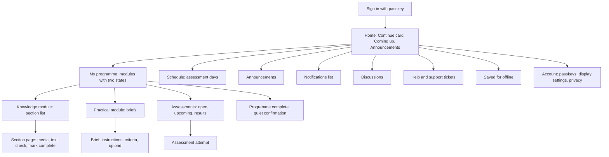
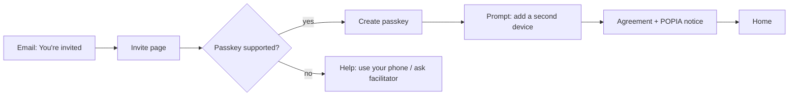
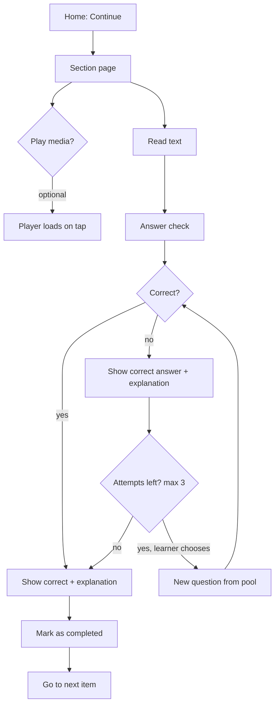

# Design brief: apps/lms

> Status: **Approved v3 (2026-11-07), communication and support added 2026-11-08.** Decisions come from the design-gate Q&A recorded in the last section. Anything this brief does not cover must go back through the design gate in `CLAUDE.md` before it is built.

## 1. Principles

1. **Calm over clever.** The feel is Coursera / Khan Academy: lots of white space, one thing at a time, no decorative motion. **Never:** gamification (points, streaks, badges, leaderboards, confetti), pop-ups or nags (modals, tours or prompts that block content), or Moodle-style clutter (sidebar widgets, link dumps).
2. **Text is the lesson.** Every section must work completely as text. Audio and video are a featured extra, never a requirement.
3. **Respect the learner's data.** Nothing heavy loads until the learner asks for it, and the cost of media is shown before they tap.
4. **Phone and laptop are both first-class.** Layouts start at 360 px and widen. Nothing is phone-only or laptop-only for learners.
5. **Always know where you are and what's next.** The learner always has the breadcrumb, a checkmark outline and a single obvious "Continue".
6. **Plain, warm words.** Use a Grade 8 reading level, second person and short sentences. Formal wording appears only where compliance needs it.
7. **Learning is not the same as competence.** "I've worked through it" and "an assessor found me competent" are shown as separate states and never blurred together.
8. **Staff screens are tools.** They are dense and efficient, but use the same tokens, so the product feels like one system.

## 2. Brand alignment (from `apps/web`)

**Same family, calmer.**

| Kept from apps/web                                                                             | Changed for the LMS                                                                                                                                                                       |
| ---------------------------------------------------------------------------------------------- | ----------------------------------------------------------------------------------------------------------------------------------------------------------------------------------------- |
| GRIT Hub horizontal logo (`grithub-logo-horz*.svg`) in the header; circle logo for favicon/PWA | **GRIT red #E92938** is limited to the logo, small brand accents and large display text. It is **never** used for errors, buttons or body text (4.34:1 on white fails AA for normal text) |
| **Inter** as the single typeface                                                               | **No Playfair Display.** Headings use Inter as well, so reading pages stay quiet                                                                                                          |
| Material look (apps/web already uses MUI)                                                      | **Material Symbols, Outlined**, weight 400, as inline SVG (see §9)                                                                                                                        |
| Charcoal **#2E303B** for text; ice blues for quiet surfaces                                    | Ocean **#4C7B9A** is darkened to **#3B6680** for links and buttons (6.18:1, up from a borderline 4.56:1)                                                                                  |
|                                                                                                | Bootstrap and the leftover Proxima Nova/Didot styles are not carried over; this is a fresh token set                                                                                      |

## 3. Information architecture



**Learner primary navigation:**

- Phones: bottom bar with 5 items: **Home · Learn · Library · Messages · More** (§14, 2026-11-08; Schedule stays out, live sessions sit on Home and the programme page).
- Laptops: top bar with the same items, plus the Display menu and the account menu.
- Both: a notifications icon (in-app list of announcements, released results and deadlines). Email remains the only off-platform channel.
- **Email preferences** (Account → Notifications):
  - Always sent, cannot be turned off: invites and sign-in help, results released, assessment-day changes, deadlines.
  - Optional, on by default: announcements, discussion replies, support ticket updates. Each can be set to _instant_, _weekly digest_ or _off_.

**Staff navigation:** a left sidebar (laptop-first), grouped by role.

- Facilitator: Learner progress (at-risk badge), Announcements, Discussions, Messages, Support tickets, Reports, Live sessions, Section notes, Assessment days (§14, 2026-11-08).
- Assessor: Marking queue, Moderation feedback (with a count badge for new outcomes), Assessment days.
- Moderator: Moderation sample, Assessment materials (read-only banks, formatives, section checks), Appeals.
- Admin: People, Qualifications, Question banks, Blueprints, Exports, Sync status, Audit log.
- External evaluator: a read-only "Evidence" area only.

## 4. Screen inventory

### Learner

| #   | Screen                                | Notes                                                                                                                                                           |
| --- | ------------------------------------- | --------------------------------------------------------------------------------------------------------------------------------------------------------------- |
| L1  | Invite landing / register passkey     | Explains passkeys in one sentence and offers "Add another device"                                                                                               |
| L2  | Sign in                               | One button: "Sign in with passkey". Help link for lost devices                                                                                                  |
| L3  | First-run: agreement and POPIA notice | Accept once; the accepted version is stored                                                                                                                     |
| L3b | First-run: QCTO learner profile       | Grouped sub-pages (About you → Contact & address → Background → Review & confirm); learner ticks "These details are correct"                                    |
| L4  | Home                                  | Greeting with first name, Continue card, Coming up, latest announcement                                                                                         |
| L5  | My programme                          | Module cards with **Learning** state + **Competence** state                                                                                                     |
| L6  | Module overview                       | Section list with checkmarks, thin bar, "x of y sections", "Download module text (PDF)"                                                                         |
| L7  | Section page                          | Coursera-style item page: grouped outline + featured media → text → check card → Mark as completed → Go to next item                                            |
| L8  | Practical brief                       | Instructions, criteria, assigned variant, upload, submission history                                                                                            |
| L9  | Assessments list                      | Open / upcoming / done; window dates; "needs connection" note                                                                                                   |
| L10 | Assessment attempt                    | One question per screen on all sizes; question navigator; review before submit; autosave; server timer                                                          |
| L11 | Results and feedback                  | Decisions appear only when released (after the batch's moderation closes); assessor feedback                                                                    |
| L12 | Schedule                              | Assessment days, venue, what to bring, attendance record                                                                                                        |
| L13 | Announcements                         | List + detail                                                                                                                                                   |
| L14 | Discussions                           | Thread list per cohort/section; thread view                                                                                                                     |
| L15 | Help                                  | FAQ + raise/view support tickets                                                                                                                                |
| L16 | Saved for offline                     | Saved sections, size used, remove                                                                                                                               |
| L17 | Account                               | Passkeys (add/rename/remove), display settings, email preferences, privacy, sign out                                                                            |
| L18 | Offline / error / empty states        | Shared patterns, see §8; text + icon only, no illustrations                                                                                                     |
| L19 | Notifications                         | In-app list; unread marker; links to the item                                                                                                                   |
| L20 | Programme complete                    | Quiet confirmation, next steps (external assessment), results summary download; states clearly it is not a qualification certificate                            |
| L21 | Live session                          | Title, time (SAST), Join on Zoom (always visible), Add to calendar (.ics), recording link, own attendance (§14, 2026-11-08)                                     |
| L22 | Messages                              | One page: Announcements · Conversations · Help, stacked; new message (pick a facilitator or the assessor); conversation; ticket form and view (§14, 2026-11-08) |

### Staff

| #   | Screen                                                                                                                              | Roles                                |
| --- | ----------------------------------------------------------------------------------------------------------------------------------- | ------------------------------------ |
| S1  | Cohort dashboard: progress table, at-risk flags, check-question struggles                                                           | Facilitator, Admin                   |
| S2  | Content editor: sections, content items, media upload, transcript (required)                                                        | Facilitator, Admin                   |
| S3  | Announcement composer                                                                                                               | Facilitator, Admin                   |
| S4  | Attendance marking (works on phone)                                                                                                 | Facilitator, Admin                   |
| S5  | Marking queue → split view: evidence left, criteria and decision right                                                              | Assessor                             |
| S6  | Attempt replay: exact questions and option order with keys overlaid                                                                 | Assessor, Moderator, Evaluator       |
| S7  | Moderation sample → batch table (pick sample) → item view: work full width, sticky decision + moderation bar                        | Moderator                            |
| S8  | People and invites, role grants                                                                                                     | Admin                                |
| S9  | Qualification / module / section structure + coverage report                                                                        | Admin                                |
| S10 | Question banks, question versions, pool health                                                                                      | Admin                                |
| S11 | Blueprints with validation and coverage                                                                                             | Admin                                |
| S12 | Exports (POE, results, attendance), job progress                                                                                    | Admin                                |
| S13 | Airtable sync status                                                                                                                | Admin                                |
| S14 | Audit log                                                                                                                           | Admin, Evaluator                     |
| S15 | Evaluator evidence home (read-only)                                                                                                 | Evaluator                            |
| S16 | Announcements: composer (title, body, Pin to top) + list with pin/unpin                                                             | Facilitator, Admin                   |
| S17 | Discussions: boards per module → threads → thread with one-level replies, pin                                                       | Facilitator, Admin                   |
| S18 | Messages: my conversations with learners; start one from an at-risk flag                                                            | Facilitator, Assessor                |
| S19 | Support tickets: filter chips, due/overdue, 90-day on-time summary; ticket with reply, status, reassign                             | Facilitator, Admin                   |
| S20 | Reports: hide or dismiss reported replies and messages                                                                              | Facilitator, Admin (messages: Admin) |
| S21 | Live sessions: schedule (Zoom), edit, cancel, recording link, phone-friendly attendance                                             | Facilitator, Admin                   |
| S22 | Section notes: programme outline per cohort with notes and recording links                                                          | Facilitator, Admin                   |
| S23 | Communication log export (cohort + dates → CSV/PDF)                                                                                 | Admin, Evaluator                     |
| S24 | Form 5 readiness: summary bar, evidence pack, one table per section 4.1–4.4 with live status, references, learner guide, backup log | Admin (edit), Evaluator (read-only)  |
| S25 | QCTO submissions: accreditation warnings, enrolment and EISA readiness deadlines, incomplete or invalid profiles, last batch        | Admin                                |

## 5. Wireframes

### L4 Home (phone)

```
┌──────────────────────────────────┐
│ [GRIT logo]                  (A) │
│                                  │
│ Good morning, Learner            │
│ ┌──────────────────────────────┐ │
│ │ Continue                     │ │
│ │ KM-01 · Section 3: Networks  │ │
│ │ ▓▓▓▓▓░░░░░  3 of 8 sections  │ │
│ │               [ Continue → ] │ │
│ └──────────────────────────────┘ │
│ Coming up                        │
│  ▸ Assessment day · Sat 14 Nov   │
│  ▸ KM-01 formative closes 20 Nov │
│ Latest announcement           ›  │
│                                  │
├──────────────────────────────────┤
│  Home    Learn   Schedule  More  │
└──────────────────────────────────┘
```

### L7 Section page (laptop): Coursera-style item page

```
┌──────────────────────────────────────────────────────────────────┐
│ [logo]   Home  Learn  Schedule  More           🔔   Aa   (A)     │
├────────────────┬─────────────────────────────────────────────────┤
│ ◧ Hide outline │ KM-01 › Section 3 of 8                          │
│ ▾ KM-01        │ Networks                                        │
│   ✓ 1 Intro    │ ┌─────────────────────────────────────────────┐ │
│   ✓ 2 Hardware │ │      [poster ~20 KB]                         │ │
│   ● 3 Networks │ │   ▶ Watch · 6 min · ~25 MB                   │ │
│   ○ 4 Security │ └─────────────────────────────────────────────┘ │
│   ○ 5 Cloud    │ ▸ Transcript                                    │
│   ▓▓▓░░ 2 of 8 │                                                 │
│ ▸ KM-02        │ Body text in a ~68ch column, 18px base, 1.6     │
│ ▸ PM-01        │ line height ...                                 │
│                │                                                 │
│                │ ┌ Check your understanding ──────────────────┐  │
│                │ │ Question stem                              │  │
│                │ │ ○ Option   ○ Option   ○ Option             │  │
│                │ │ ○ All of the above (pinned)                │  │
│                │ │                           [Check answer]   │  │
│                │ └────────────────────────────────────────────┘  │
│                │ [ ✓ Mark as completed ]  (after answering)      │
│                │                          [ Go to next item → ]  │
└────────────────┴─────────────────────────────────────────────────┘
```

The outline is grouped by module (current module expanded, others collapsed), open by default from 900 px, and can be hidden. On phones it becomes an "Outline" button that opens a sheet, the media block goes full-bleed, and "Mark as completed" / "Go to next item" sit in a sticky bottom bar. Icons shown here as symbols are Material Symbols Outlined in the build.

### Check card states

```
Answered correctly                       Answered incorrectly (attempt 1 of 3)
┌ Check your understanding ─────────┐    ┌ Check your understanding ──────────────┐
│ ✓ Correct                         │    │ ✗ Not quite                             │
│ ● Router   ← your answer          │    │ ● Switch  ← your answer                 │
│ Explanation text...               │    │ ✓ Router  ← correct answer              │
└───────────────────────────────────┘    │ Explanation text...                     │
                                         │ [Try another question] (2 left)         │
                                         └─────────────────────────────────────────┘
```

After the third attempt, "Try another question" disappears. The status is never shown with colour alone; each state has an icon and a word.

### L10 Assessment attempt (phone and laptop)

```
┌──────────────────────────────────────────┐
│ KM-01 Formative 2     ⏱ 24:10   ✓ Saved  │
├──────────────────────────────────────────┤
│ Question 4 of 12                 ⚑ Flag  │
│                                          │
│ Question stem ...                        │
│  ○ Option                                │
│  ○ Option                                │
│  ○ Option                                │
│  ○ None of the above                     │
│                                          │
│ [← Previous]                  [Next →]   │
├──────────────────────────────────────────┤
│ 1✓ 2✓ 3✓ 4● 5○ 6⚑ 7○ 8○ 9○ 10○ 11○ 12○   │
│                       [Review & submit]  │
└──────────────────────────────────────────┘
```

### L20 Programme complete (quiet)

```
┌──────────────────────────────────────────┐
│ ✓ You've completed all modules           │
│                                          │
│ Every module in this programme has been  │
│ assessed and moderated as Competent.     │
│                                          │
│ What happens next                        │
│  • External assessment (EISA): dates and │
│    how to prepare                        │
│  • Your facilitator will contact you     │
│                                          │
│ [Download results summary (PDF)]         │
│                                          │
│ This is not a qualification certificate. │
│ Certificates are issued by the QCTO.     │
└──────────────────────────────────────────┘
```

### S5 Assessor marking (laptop, dense)

```
┌ Marking queue › Learner · PM-01 Brief B ──────────────────────────────────────┐
│ ┌ Evidence ─────────────────────────┐ ┌ Criteria and decision ─────────────────┐ │
│ │ file-1.pdf  (preview)             │ │ ☐ AC1 ...   ☐ AC2 ...  ☐ AC3 ...       │ │
│ │ photo-2.jpg                       │ │ Feedback [............................]│ │
│ │ Submitted 12 Nov · attempt 1      │ │ ( ) Competent  ( ) Not yet competent   │ │
│ │                                   │ │ [Save draft]       [Record decision]   │ │
│ └───────────────────────────────────┘ └────────────────────────────────────────┘ │
│ ← Previous in queue                                          Next in queue →    │
└─────────────────────────────────────────────────────────────────────────────────┘
```

## 6. Key flows

### First sign-in (invite)



### Studying a section



"Mark complete" is enabled once the check has been answered at least once (right or wrong).

### Resume

"Continue" always opens the last section the learner viewed, at their scroll position (saved on the server). If that section is complete, it opens the next incomplete section.

### Practical submission

Brief → choose files → **direct upload with per-file progress** (it can resume after a drop) → review list → Submit → confirmation with timestamp → status "Being assessed" → (assessor decides, moderator samples) → **all decisions for that assessment and cohort are released together when the moderator closes the sample** → notification + feedback.

### Assessment day

The learner opens Schedule → assessment day → attempt (supervised). The facilitator marks attendance on a phone (S4). Answers autosave on every change, and a banner shows "Saved" / "Offline, answers kept on this device".

## 7. States: what "done" looks like

| Level     | Learning state                                                                                 | Competence state                                                                                                                                                                               |
| --------- | ---------------------------------------------------------------------------------------------- | ---------------------------------------------------------------------------------------------------------------------------------------------------------------------------------------------- |
| Section   | ○ Not started · ● In progress · ✓ Complete (learner marked complete after answering the check) | n/a                                                                                                                                                                                            |
| Module    | "x of y sections" + thin bar → **Learning complete**                                           | Not assessed · Submitted · Being assessed · **Competent** / Not yet competent (with feedback). Results are visible **only after release**, which happens when moderation for that batch closes |
| Programme | Modules completed count                                                                        | **Programme complete** page (L20) when every module is released as Competent                                                                                                                   |

## 8. Components

**Foundations:** AppShell (learner), StaffShell (sidebar), TopBar, BottomNav, Breadcrumb, OutlineDrawer/Sheet (grouped by module), DisplayMenu (text size + theme), SkipLink, Icon (Material Symbols Outlined, inline SVG), NotificationButton + NotificationList.

**Learning:** ContinueCard, ModuleCard (two-state), SectionList, ProgressBar (thin), StatusIcon (not started / in progress / complete), RichText (prose styles), MediaFeature (poster + play + duration + size → Mux player on tap), AudioBar, TranscriptPanel, CheckCard (+ result states), MarkCompleteButton, NextItemBar, SaveOfflineButton, PdfDownloadButton, ProgrammeCompletePanel.

**Assessment:** AttemptHeader (timer, autosave status), QuestionView (single/multi), OptionList (radio/checkbox with large hit area), QuestionNavigator (answered/flagged), ReviewPage, SubmitConfirm, ResultSummary, FeedbackBlock.

**Practical:** BriefView, CriteriaList, FileUploader (direct, resumable, progress), SubmissionHistory.

**Communication:** AnnouncementItem, ThreadList, PostComposer, TicketForm.

**Feedback and system:** Banner (info/success/warning/danger), Toast (non-critical only), InlineError, EmptyState (icon + text, no illustration), OfflineBanner, Skeleton, ConfirmDialog, Badge/Tag.

**Staff:** DataTable (sort, filter, bulk select, sticky header), FilterBar, SplitView, EvidenceViewer, DecisionForm, AttemptReplay, AttendanceList, CoverageMatrix, AuditTable, JobProgress.

## 9. Tokens

### Typography (Inter only, via `next/font`, subset `latin`, variable font)

| Token       | Size / line height | Use                          |
| ----------- | ------------------ | ---------------------------- |
| `text-xs`   | 13 / 18            | Staff tables metadata only   |
| `text-sm`   | 15 / 22            | Captions, helper text        |
| `text-base` | **18 / 29 (1.6)**  | Learner reading text         |
| `text-ui`   | 16 / 24            | Learner UI, staff body       |
| `text-lg`   | 20 / 30            | Lead paragraph, card titles  |
| `text-xl`   | 24 / 32            | H3 / section titles on phone |
| `text-2xl`  | 30 / 38            | H2 / page title on phone     |
| `text-3xl`  | 36 / 44            | Page title on laptop         |

- Weights: 400 body, 600 headings/buttons. No italic for long passages.
- Reading measure: max **68ch**.
- Display menu text sizes: **S 16 · M 18 (default) · L 20 · XL 22** for reading text. The UI scales with it via `rem`. The choice is stored per user.

### Iconography and imagery

- **Material Symbols, Outlined style**, weight 400, grade 0, optical size 20/24. Imported per icon as inline SVG components (no icon font), so only the icons used are shipped.
- Icons sit alongside text labels; an icon alone is used only for universally understood actions (close, menu, notifications) and always has an accessible name.
- Icons use `currentColor`, so they follow text/accent tokens in both themes.
- **No imagery** on the learner side: no illustrations or photos, including empty states and the completion page. Content authors may still include diagrams and images inside lesson text.

### Spacing, radius, elevation

- Spacing scale (4-pt): 4, 8, 12, 16, 24, 32, 48, 64. Learner pages use 24–48 between blocks; staff pages use 8–16.
- Radius: 6 (inputs), 10 (cards), 999 (pills).
- Elevation: borders first, with one subtle shadow level for overlays only.
- Breakpoints: 360 (base), 600, 900 (outline drawer becomes inline), 1200.

### Colour (contrast measured against the page background)

| Token                                    | Light                       | Dark             | Notes                                                                  |
| ---------------------------------------- | --------------------------- | ---------------- | ---------------------------------------------------------------------- |
| `bg`                                     | #FFFFFF                     | #15161B          |                                                                        |
| `surface`                                | #FFFFFF                     | #1E2028          | cards                                                                  |
| `surface-sunken`                         | #F0F4F7 (ice50)             | #121318          | outline, check card                                                    |
| `text`                                   | #2E303B (charcoal) · 13.1:1 | #E8E9EE · 14.9:1 |                                                                        |
| `text-muted`                             | #5A5D6B · 6.5:1             | #A6A9B6 · 7.7:1  |                                                                        |
| `border`                                 | #8A8E9C · 3.3:1 (non-text)  | #6B6F7D · 3.6:1  | input borders; hairlines may be lighter                                |
| `accent` (links, primary buttons, focus) | #3B6680 · 6.2:1             | #8CB8D4 · 8.5:1  | darkened ocean                                                         |
| `on-accent`                              | #FFFFFF · 6.2:1             | #15161B · 8.5:1  | button text                                                            |
| `brand`                                  | #E92938                     | #F0505D · 5.2:1  | logo/accents only; light value 4.34:1, so large text and non-text only |
| `success`                                | #3F7A1F · 5.2:1             | #8DC26A · 8.7:1  | always with ✓ icon + word                                              |
| `danger`                                 | #B42318 · 6.6:1             | #F08A80 · 7.4:1  | always with ✗/! icon + word                                            |
| `warning`                                | #8A5A00 · 5.9:1             | #E0B04A · 9.0:1  |                                                                        |
| `focus-ring`                             | 2 px `accent` + 2 px offset | same             |                                                                        |

Themes: Light / Dark / **System (default)** in the Display menu, stored per user. **MVP: learner screens only.** Staff screens are light-only at first; they use the same tokens so dark mode can follow later. Tokens are CSS custom properties; components never use raw hex.

## 10. Accessibility rules (WCAG 2.2 AA)

- Contrast: text 4.5:1 minimum (the tokens above reach 5.2:1+), UI components and boundaries 3:1.
- Fully keyboard operable. Visible focus everywhere, and focus is never obscured by sticky bars (2.4.11).
- Target size at least 24×24 CSS px (2.5.8); learner controls aim for 44×44.
- Status is never shown by colour alone (icon + text).
- Semantic headings (one H1 per page), landmarks, a skip link, and a correct `lang` attribute.
- Check feedback and autosave status use `aria-live="polite"`. Assessment timers announce only at set intervals.
- Every video has captions; every audio/video item has a transcript (it cannot be published without one).
- Layouts reflow at 320 px and 400% zoom without horizontal scroll (except data tables).
- Respect `prefers-reduced-motion`. There is no autoplay anywhere.
- Timed assessments: show the remaining time and support extra-time accommodations set by staff (2.2.1).
- Authentication: the passkey flow needs no cognitive test (3.3.8).
- Forms: labels always visible, errors stated in text next to the field and summarised at the top.
- Testing: axe in CI plus manual NVDA/TalkBack and VoiceOver passes on key flows each release.

## 11. Low-data rules

- **Budget:** the learner section page should be **≤ 150 KB transferred** (HTML+CSS+JS+fonts, excluding media) on first load, and **≤ 30 KB** on later section navigation.
- No media bytes or player script before a tap. The poster is ≤ 20 KB (AVIF/WebP). Audio-only items show a slim bar with no poster.
- Always show the duration and **estimated data size** before playback. Quality is **adaptive only** (the player picks the rendition from connection speed); there is no manual quality menu.
- One variable Inter font file, subset, `font-display: swap`.
- Images in content are responsive (`srcset`), lazy-loaded and compressed. Admins are warned when an upload exceeds a set size.
- No third-party scripts on learner pages (no analytics beyond what consent allows, and no chat widgets).
- Server-rendered pages that work before JS hydrates, with progressive enhancement for checks and autosave.
- **Save for offline:** saves a section's text, images and (opt-in) audio through a service worker. Check answers made offline queue up and sync. Assessments always need a connection.
- Admins are warned when an uploaded content image is over 300 KB or a poster is over 20 KB.
- Icons are inline SVG (a few hundred bytes each), never an icon font.
- **Module PDF download** is generated on the server and cached per content version; the button shows the file size before download.

## 12. Staff screen rules

- Laptop-first. **Tablet landscape (from ~900 px) supports marking and moderation**: the split view stays side by side. Below that, panels stack and become read-only. Phones get read-only views plus **attendance marking**, which is fully phone-friendly.
- Same tokens, compact spacing scale, `text-ui`/`text-xs`. Light theme only in the MVP.
- Tables: sortable, filterable, bulk actions, sticky header, filters saved in the URL.
- Split views for marking and moderation, with keyboard shortcuts for next/previous.
- Moderators have a **Close sample and release results** action per assessment and cohort; it shows how many learners will be notified before confirming, and stays disabled (with the reasons listed) until the sample meets the cohort's rate and every sampled decision is agreed with actions done (§14, 2026-11-08).
- Destructive or irreversible actions (record decision, moderate, revoke passkey) need a confirmation that states what changes.
- The evaluator sees the same screens, read-only, with a persistent "Read-only evaluator access, expires dd MMM" banner.

## 13. Still undecided

Nothing is undecided in the design itself. One input is still pending:

- **Copy guide (owned by GRIT Hub).** Someone at GRIT Hub will write the wording for empty states, errors, offline messages, confirmations and success messages. The LMS will use their text as written. Until it arrives, placeholder strings are marked `TODO(copy)` and must follow §1 principle 6 (warm, plain, Grade 8, second person).

## 14. Design-gate record

| Date       | Area             | Question                       | Answer                                                                                                                                                                                                                                                                                                                                               |
| ---------- | ---------------- | ------------------------------ | ---------------------------------------------------------------------------------------------------------------------------------------------------------------------------------------------------------------------------------------------------------------------------------------------------------------------------------------------------- |
| 2026-11-07 | Brand            | How closely to match apps/web? | Same family, calmer: keep logo, Inter, charcoal/ocean/ice; red as a small accent; no Playfair                                                                                                                                                                                                                                                        |
| 2026-11-07 | Tone             | Voice for learner-facing text  | Warm and plain                                                                                                                                                                                                                                                                                                                                       |
| 2026-11-07 | Learners         | Main devices                   | Mix of phone and laptop                                                                                                                                                                                                                                                                                                                              |
| 2026-11-07 | Learners         | Data/connectivity              | Mixed: some Wi-Fi, some mobile data                                                                                                                                                                                                                                                                                                                  |
| 2026-11-07 | Learners         | Reading level                  | Plain language, ~Grade 8                                                                                                                                                                                                                                                                                                                             |
| 2026-11-07 | Learners         | Languages                      | English now; i18n layer so more can be added later                                                                                                                                                                                                                                                                                                   |
| 2026-11-07 | Learning page    | Layout                         | Single column + collapsible outline                                                                                                                                                                                                                                                                                                                  |
| 2026-11-07 | Learning page    | Progress                       | Checkmarks + thin bar, "x of y sections"                                                                                                                                                                                                                                                                                                             |
| 2026-11-07 | Learning page    | Media placement                | Featured player at top                                                                                                                                                                                                                                                                                                                               |
| 2026-11-07 | Learning page    | Before play                    | Tiny poster + duration + data size; no player script until tap                                                                                                                                                                                                                                                                                       |
| 2026-11-07 | Learning page    | Transcripts                    | Always, collapsed by default (+ captions)                                                                                                                                                                                                                                                                                                            |
| 2026-11-07 | Learning page    | Text size                      | A−/A+ control, remembered per user                                                                                                                                                                                                                                                                                                                   |
| 2026-11-07 | Section check    | Presentation                   | Inline card at the end of the section                                                                                                                                                                                                                                                                                                                |
| 2026-11-07 | Section check    | Feedback                       | Reveal correct answer (+ explanation)                                                                                                                                                                                                                                                                                                                |
| 2026-11-07 | Section check    | Retries                        | First attempt + 2 retries (3 max), fresh question each time                                                                                                                                                                                                                                                                                          |
| 2026-11-07 | Section check    | Gating                         | Must answer, need not pass                                                                                                                                                                                                                                                                                                                           |
| 2026-11-07 | Navigation       | After login                    | "Continue" card + Coming up                                                                                                                                                                                                                                                                                                                          |
| 2026-11-07 | Navigation       | Section done                   | Learner marks complete (after answering the check)                                                                                                                                                                                                                                                                                                   |
| 2026-11-07 | Navigation       | Module/programme done          | Two separate states: learning complete vs competent                                                                                                                                                                                                                                                                                                  |
| 2026-11-07 | Theme            | Dark mode                      | Follow system + manual toggle                                                                                                                                                                                                                                                                                                                        |
| 2026-11-07 | Accessibility    | Target                         | WCAG 2.2 AA                                                                                                                                                                                                                                                                                                                                          |
| 2026-11-07 | Offline          | Offline content                | Save section for offline reading; assessments online only                                                                                                                                                                                                                                                                                            |
| 2026-11-07 | Staff UI         | Density                        | Dense, laptop-first, same tokens                                                                                                                                                                                                                                                                                                                     |
| 2026-11-07 | References       | Learning page reference        | Coursera-style item page (grouped outline, Mark as completed, Go to next item)                                                                                                                                                                                                                                                                       |
| 2026-11-07 | References       | Home reference                 | Single "Continue" focus                                                                                                                                                                                                                                                                                                                              |
| 2026-11-07 | References       | Dislikes                       | Pop-ups and nags; cluttered Moodle-style blocks; gamification                                                                                                                                                                                                                                                                                        |
| 2026-11-07 | Icons            | Delivery and style             | Material Symbols, Outlined, as inline SVG                                                                                                                                                                                                                                                                                                            |
| 2026-11-07 | Results          | When learners see "Competent"  | Only after moderation: results released per batch when the moderator closes the sample                                                                                                                                                                                                                                                               |
| 2026-11-07 | Imagery          | Illustrations/photos           | No imagery at all on the learner side                                                                                                                                                                                                                                                                                                                |
| 2026-11-07 | Completion       | Programme complete             | Quiet confirmation page; not a certificate                                                                                                                                                                                                                                                                                                           |
| 2026-11-07 | Assessment       | Attempt layout                 | One question per screen + navigator, all sizes                                                                                                                                                                                                                                                                                                       |
| 2026-11-07 | Notifications    | Beyond email                   | In-app notification list only                                                                                                                                                                                                                                                                                                                        |
| 2026-11-07 | Extras           | Chosen                         | Module text as PDF download; greeting with first name                                                                                                                                                                                                                                                                                                |
| 2026-11-07 | Extras           | Not chosen                     | Staff dark mode in MVP; Data saver switch                                                                                                                                                                                                                                                                                                            |
| 2026-11-07 | Low data         | Video quality                  | Adaptive only, no manual quality menu; page budgets as in §11                                                                                                                                                                                                                                                                                        |
| 2026-11-07 | Notifications    | Email preferences              | Essential always on; announcements, discussions and tickets optional (instant, weekly digest or off)                                                                                                                                                                                                                                                 |
| 2026-11-07 | Copy             | Empty-state and error wording  | Written by someone at GRIT Hub; LMS uses their text                                                                                                                                                                                                                                                                                                  |
| 2026-11-07 | Staff UI         | Tablet marking                 | Yes, tablet landscape supported; smaller screens read-only                                                                                                                                                                                                                                                                                           |
| 2026-11-07 | Approval         | Design brief status            | v3 approved                                                                                                                                                                                                                                                                                                                                          |
| 2026-11-07 | Navigation       | URL structure                  | Learner at `/` (route group `(learn)`: `/`, `/learn`, `/schedule` …); staff under `/staff/…`; admin under `/admin/…`                                                                                                                                                                                                                                 |
| 2026-11-07 | Placeholder      | Home before auth/data          | Minimal holding page: logo, "GRIT Hub Learning", one line; tokens only; copy is `TODO(copy)`                                                                                                                                                                                                                                                         |
| 2026-11-07 | Components       | packages/ui reuse              | Wire up only; render no packages/ui components until they are restyled with the LMS tokens                                                                                                                                                                                                                                                           |
| 2026-11-07 | Sign-in          | Layout                         | Email field (passkey autofill) + primary "Sign in with passkey"; quieter "Email me a sign-in link"; "Lost access? Get help"                                                                                                                                                                                                                          |
| 2026-11-07 | Setup            | First-time setup layout        | One step per screen with "Step x of 3": details → POPIA notice and consent → passkey                                                                                                                                                                                                                                                                 |
| 2026-11-07 | Setup            | Learner may skip passkey       | Yes, "Skip for now"; gentle reminder on Home. Staff who need step-up can't skip                                                                                                                                                                                                                                                                      |
| 2026-11-07 | Admin            | CSV import                     | Validate → preview table with per-row status → confirm; only valid rows imported                                                                                                                                                                                                                                                                     |
| 2026-11-07 | Admin            | People screen                  | One table + status filter chips (All · Invited · Active · Expired invite · Deactivated); row actions in a "⋯" menu; Invite / Import buttons top right                                                                                                                                                                                                |
| 2026-11-08 | Content          | Section text format            | Markdown subset: headings, lists, links, images (alt text required), code blocks, callouts (`> [!NOTE]` / `[!TIP]` / `[!WARNING]`); no raw HTML                                                                                                                                                                                                      |
| 2026-11-08 | Low data         | "Text only" toggle             | Not wanted. Media never autoplays and loads only on tap; every section must work fully as text                                                                                                                                                                                                                                                       |
| 2026-11-08 | Navigation       | Digital library                | Fifth top-level item: Home · Learn · Library · (Schedule) · More                                                                                                                                                                                                                                                                                     |
| 2026-11-08 | Navigation       | Schedule and More              | Schedule left out for now; More is a simple menu (Account & passkeys, Help, Sign out)                                                                                                                                                                                                                                                                |
| 2026-11-08 | Home             | Multiple programmes            | One card per programme with the learner's status and its own Continue                                                                                                                                                                                                                                                                                |
| 2026-11-08 | Learning page    | Wireframe                      | Approved as drawn (L7 with Listen/Watch, transcript note, check card, Mark as completed, Go to next item; sticky bar on phones)                                                                                                                                                                                                                      |
| 2026-11-08 | Media            | Player                         | Mux Player, script and signed token fetched only on tap                                                                                                                                                                                                                                                                                              |
| 2026-11-08 | Staff            | Progress report                | Printable page per learner + CSV download                                                                                                                                                                                                                                                                                                            |
| 2026-11-08 | Assessment       | Summative unlock               | Assessor opens each learner's paper after marking them present and checking ID; nobody can start from home                                                                                                                                                                                                                                           |
| 2026-11-08 | Assessment       | Formative results              | Auto-graded; score, correct answers and explanations straight after submitting; no assessor or moderation                                                                                                                                                                                                                                            |
| 2026-11-08 | Assessment       | Short-answer rubric            | Criteria with mark ranges; the item score is the sum                                                                                                                                                                                                                                                                                                 |
| 2026-11-08 | Assessment       | Appeals                        | Decided by a moderator who did not make the decision: uphold, or reassess by a different assessor                                                                                                                                                                                                                                                    |
| 2026-11-08 | Assessment       | Summative decision             | Assessor decides Competent / Not yet competent; score vs pass mark shown as a suggestion                                                                                                                                                                                                                                                             |
| 2026-11-08 | Assessment       | Summative attempts             | 1 + 1 reassessment by default (configurable); reassessment only after a released NYC or an appeal                                                                                                                                                                                                                                                    |
| 2026-11-08 | Assessment       | Appeal window                  | 7 days after results are released                                                                                                                                                                                                                                                                                                                    |
| 2026-11-08 | Assessment       | Facilitators and keys          | No: keys, replays and analytics for assessors, moderators and evaluators only                                                                                                                                                                                                                                                                        |
| 2026-11-08 | Assessment       | Time up                        | Server auto-submits the saved answers at the deadline (plus extra time); unanswered = wrong                                                                                                                                                                                                                                                          |
| 2026-11-08 | Assessment       | Connection drops               | Online only; answers save immediately; "Not saved – reconnecting" keeps the answer; resume on any device; assessor can pause and extend                                                                                                                                                                                                              |
| 2026-11-08 | Assessment       | Question flags                 | Standard defaults: at least 20 responses; too easy ≥90% correct, too hard ≤30%, misleading = a wrong option beats the key or negative discrimination                                                                                                                                                                                                 |
| 2026-11-08 | Assessment       | Paper export                   | Server-generated PDF built on demand from the attempt records; SHA-256 of each export audited                                                                                                                                                                                                                                                        |
| 2026-11-08 | Assessment       | Timer                          | Hideable; reappears and is announced politely at 10, 5 and 1 minutes left                                                                                                                                                                                                                                                                            |
| 2026-11-08 | Navigation       | Finding assessments            | Assessments block on each programme page (open, upcoming, done); bottom nav unchanged                                                                                                                                                                                                                                                                |
| 2026-11-08 | Staff UI         | Marking layout                 | Per-learner split view (paper left, rubric and decision right); j/k for next/previous                                                                                                                                                                                                                                                                |
| 2026-11-08 | Staff UI         | Assessment-day register        | One row per learner: attendance chips, ID checkbox, Open paper; ⋯ for pause, extra time; assessor signs off                                                                                                                                                                                                                                          |
| 2026-11-08 | Admin            | Authoring scope                | Blueprint and schedule forms; retire or new version from analytics; full question-bank authoring/import still open                                                                                                                                                                                                                                   |
| 2026-11-08 | Assessment       | Learner screens                | Approved: start screen, L10 attempt, review & submit, formative result with answers, summative submitted, L11 result + appeal                                                                                                                                                                                                                        |
| 2026-11-08 | Staff UI         | Staff screens                  | Approved: marking queue, split view, replay/PDF, question analytics, coverage report, appeals                                                                                                                                                                                                                                                        |
| 2026-11-08 | Setup            | Profile step placement         | Four steps: details → notice + consents → QCTO profile → passkey ("Step x of 4"). Supersedes the 2026-11-07 "Step x of 3" row                                                                                                                                                                                                                        |
| 2026-11-08 | Setup            | Profile layout                 | Grouped sub-pages in one step (About you → Contact & address → Background → Review & confirm), each saved on Continue                                                                                                                                                                                                                                |
| 2026-11-08 | Setup            | Confirmation                   | Learner must tick "These details are correct" on Review & confirm                                                                                                                                                                                                                                                                                    |
| 2026-11-08 | Setup            | QCTO-sharing consent           | Separate required tick on the notice step, naming the QCTO and Airtable; own consent record (version, text hash, date) = POPI Act Agree/Date                                                                                                                                                                                                         |
| 2026-11-08 | Setup            | If QCTO sharing declined       | Setup can't finish; plain explanation (QCTO registration and certification need it) + Information Officer contact                                                                                                                                                                                                                                    |
| 2026-11-08 | Setup            | Coded fields                   | Radios for lists of ~6 or fewer; native select for long lists; Stats SA area is a required type-ahead filtered by province (official list imported by GRIT Hub); plain labels, never codes                                                                                                                                                           |
| 2026-11-08 | Setup            | Sensitive fields               | One "why we ask" line under equity and disability; "Unknown / prefer not to say" only where the QCTO code list has one                                                                                                                                                                                                                               |
| 2026-11-08 | Setup            | Existing learners              | None yet (test accounts only): profile is simply required, no migration UX                                                                                                                                                                                                                                                                           |
| 2026-11-08 | Profile          | Data entry                     | Forms only, no admin CSV pre-fill. Learner fills it at setup; SDP admin can open the same form to fill in or correct                                                                                                                                                                                                                                 |
| 2026-11-08 | Profile          | Edits after setup              | Admin only; learner can view under More → Account. Changes audit-logged (field names only)                                                                                                                                                                                                                                                           |
| 2026-11-08 | Profile          | Storage                        | ID/passport number, equity and disability data encrypted at application level; HMAC for duplicate-ID checks                                                                                                                                                                                                                                          |
| 2026-11-08 | QCTO             | Submission                     | Stage 1 only for now (enrolment columns → QCTO learner enrolments address, within 21 working days of training starting). Stage 2 (readiness → QCTO EISA readiness address, ≥3 months before the EISA) later. SDP admin (step-up) presses "Send N learners to QCTO" per cohort; only ready learners; audited (count, SHA-256, recipient). No download |
| 2026-11-08 | QCTO             | Attachment                     | Unencrypted .xlsx filled from the official QCTO template, all cells text (owner's decision; risk noted in compliance/popia.md). Never PDF                                                                                                                                                                                                            |
| 2026-11-08 | QCTO             | Recipient                      | Two env vars, QCTO_ENROLMENT_EMAIL and QCTO_READINESS_EMAIL, shown on the confirm screen; sending admin CC'd                                                                                                                                                                                                                                         |
| 2026-11-08 | Airtable         | Profile copy                   | Full learner profile is copied to Airtable too (owner's decision; cross-border exposure noted in compliance/popia.md)                                                                                                                                                                                                                                |
| 2026-11-08 | QCTO             | Deadlines                      | Send page shows "Enrolment due by <date>" (21 working days from cohort start, skipping weekends and SA public holidays); warning when close or overdue; last-sent date. No emails or nags                                                                                                                                                            |
| 2026-11-08 | Profile          | Birth date and gender          | Always asked separately; must match the SA ID number (error next to the field)                                                                                                                                                                                                                                                                       |
| 2026-11-08 | Profile          | Postal address                 | "My postal address is the same as my home address", ticked by default; unticking reveals postal fields                                                                                                                                                                                                                                               |
| 2026-11-08 | Profile          | Progress inside step           | Keep "Step 3 of 4" bar; line under it "Your details · Part x of 4: <part>"; "← Back" link on each part                                                                                                                                                                                                                                               |
| 2026-11-08 | Profile          | Learner view                   | Read-only under More → Account; ID/passport masked to the last 4 characters (shown in full on the setup review screen)                                                                                                                                                                                                                               |
| 2026-11-08 | Profile          | Admin entry                    | "QCTO profile" in the People row ⋯ menu → one dense page with all groups + Save; People shows profile status (Not started / In progress / Confirmed)                                                                                                                                                                                                 |
| 2026-11-08 | Practical        | Evidence storage               | Vercel Blob, private access; viewed only via 5-minute signed links issued to the learner and in-scope assessors, moderators, evaluators (staff views audited)                                                                                                                                                                                        |
| 2026-11-08 | Practical        | File limits                    | PDF, images, Word/Excel/PowerPoint, TXT, ZIP; 20 MB per file; 10 items per submission                                                                                                                                                                                                                                                                |
| 2026-11-08 | Practical        | Video evidence                 | Link only (unlisted YouTube/Drive/OneDrive); URL and time recorded                                                                                                                                                                                                                                                                                   |
| 2026-11-08 | Practical        | Links                          | Allow-list: YouTube, Vimeo, Google Drive/Docs, OneDrive/SharePoint, Dropbox, GitHub, GitLab, Bitbucket, Figma, Canva, CodePen, Replit; learner confirms assessors can open them                                                                                                                                                                      |
| 2026-11-08 | Practical        | Rubric                         | Met / Not yet met per criterion with optional comment; Competent suggested only when all are met; assessor decides                                                                                                                                                                                                                                   |
| 2026-11-08 | Practical        | In person                      | Brief mode: 'submit evidence' or 'observed on the day'; observed uses the day register; assessor marks while observing and may attach photos, notes or links                                                                                                                                                                                         |
| 2026-11-08 | Practical        | Submitting                     | Draft, then 'Submit for assessment' locks it; new attempt only after a released NYC or a reassess appeal; 1 + 1 by default; 7-day appeals; released at moderation close                                                                                                                                                                              |
| 2026-11-08 | Practical        | Virus scan                     | Placeholder passes and records 'not scanned'; with a real scanner, staff see only clean files and infected files are removed                                                                                                                                                                                                                         |
| 2026-11-08 | Practical        | Brief page (L8)                | Approved as drawn: status, assigned variant, full instructions, criteria, evidence list with per-file progress, link field, confirm + Submit, history with appeal                                                                                                                                                                                    |
| 2026-11-08 | Practical        | Marking (S5)                   | Approved as drawn: evidence left (inline images, open files, links), Met/Not yet met + comments, feedback, decision right; one queue with a Practical filter; read-only for moderators and evaluators                                                                                                                                                |
| 2026-11-08 | Moderation       | Assessors per cohort           | One assessor per cohort (QCTO expects one per programme); the LMS refuses a second assessor grant on a cohort                                                                                                                                                                                                                                        |
| 2026-11-08 | Moderation       | Sampling rate                  | Set by the SDP admin per cohort (default 25%); the moderator sees it and can't lower it. Minimum sample = rate × decisions in the batch, rounded up                                                                                                                                                                                                  |
| 2026-11-08 | Moderation       | Who picks the sample           | The moderator picks which decisions go in the sample; the LMS enforces the minimum. A sampled decision can't be removed once moderated                                                                                                                                                                                                               |
| 2026-11-08 | Moderation       | Close and release              | Blocked until the minimum sample is met and every sampled decision's latest version is Agree, or Agree with actions with the assessor's 'Actions done' ticked                                                                                                                                                                                        |
| 2026-11-08 | Moderation       | Verdict                        | Agree / Agree with actions / Disagree, with comments and required actions (free text). Disagree: the assessor records a new decision (history kept, learner work never changed) and it returns to the sample for another check                                                                                                                       |
| 2026-11-08 | Moderation       | Required actions               | Free text; the assessor ticks 'Actions done' with a short note, which the moderator sees                                                                                                                                                                                                                                                             |
| 2026-11-08 | Moderation       | Assessor sees the outcome      | On the marking page and queue status, a 'Moderation feedback' list, a sidebar count badge for unseen outcomes (no notification system yet), and an email on Disagree or actions (link only, no learner names)                                                                                                                                        |
| 2026-11-08 | Moderation       | Appeal reassessment            | Same (only) assessor marks the new attempt; that decision is always in the sample                                                                                                                                                                                                                                                                    |
| 2026-11-08 | Moderation       | S7 moderation view             | Option B: learner's work full width (exact paper and option order, or practical evidence); a sticky bottom bar with the assessor's decision summary, history toggle and the moderation form; previous/next in sample (J/K). Below ~900 px read-only per §12                                                                                          |
| 2026-11-08 | Moderation       | Batch page                     | One table of all decisions with an 'In sample' checkbox per row (locked once moderated), rate and progress plus the release panel at the top, filters All / In sample / NYC / Not checked                                                                                                                                                            |
| 2026-11-08 | Moderation       | Report export                  | Per batch, PDF and CSV: rate, sample, each sampled decision with verdict, comments, actions and status, moderator, release date                                                                                                                                                                                                                      |
| 2026-11-08 | Moderation       | Formatives and banks           | 'Assessment materials' in the moderator sidebar, read-only: banks → questions → every version with keys and rubric; formative blueprints and section checks; formative attempts per cohort opening the exact replay. No formative verdicts                                                                                                           |
| 2026-11-08 | Moderation       | Question versions              | Moderators can't retire questions or create versions (assessors only); they flag issues in their comments                                                                                                                                                                                                                                            |
| 2026-11-08 | Comms            | Learner navigation             | New **Messages** tab: Home · Learn · Library · Messages · More. Messages holds Announcements, Conversations (direct messages) and Help (tickets) as three stacked sections on one page, newest first, unread dots. Live sessions on Home "Coming up" and a programme-page block; discussions on module pages                                         |
| 2026-11-08 | Comms            | Notification bell              | Built now: bell in the learner top bar (phones and laptops), unread dot, list linking to each item; no pop-ups                                                                                                                                                                                                                                       |
| 2026-11-08 | Comms            | Email preferences              | Full: announcements, discussion replies, message replies and ticket updates each instant / weekly digest / off (default instant); digest Monday 07:00 SAST via Vercel cron. Essential emails (results, assessment-day and session changes, deadlines) always sent                                                                                    |
| 2026-11-08 | Comms            | Announcement composer          | Title + body (plain text with the section Markdown subset rendered), one cohort, publish now; **Pin to top** (one pinned per cohort, shown first in Messages and on Home). No scheduling, no multi-cohort send                                                                                                                                       |
| 2026-11-08 | Discussions      | Boards                         | One board per module per cohort, no section tags, no general board. Shown as a Discussion block on the module page                                                                                                                                                                                                                                   |
| 2026-11-08 | Discussions      | Threads                        | Only facilitators start threads; learners reply. Replies nest one level (reply to a reply, indented once). Facilitators can pin a thread                                                                                                                                                                                                             |
| 2026-11-08 | Messages         | Who                            | Learner ↔ a named facilitator or the cohort's assessor (learner picks the person; only that person sees it). No learner-to-learner messages                                                                                                                                                                                                         |
| 2026-11-08 | Messages         | Attachments                    | Text and links only in messages and posts; no uploads                                                                                                                                                                                                                                                                                                |
| 2026-11-08 | Comms            | Export log                     | Per cohort + date range: announcements, discussions, direct messages, tickets, live sessions and attendance, as CSV and PDF. SDP admin and external evaluator; each export audited (count, SHA-256)                                                                                                                                                  |
| 2026-11-08 | Tickets          | Targets                        | First reply within 1 working day, resolved within 5 working days, all categories. Working hours Mon–Fri 08:00–17:00 SAST, skipping SA public holidays                                                                                                                                                                                                |
| 2026-11-08 | Tickets          | Routing                        | Academic → the cohort's facilitators; Technical and Admin → SDP admins; staff can reassign                                                                                                                                                                                                                                                           |
| 2026-11-08 | Tickets          | Closing                        | Staff close manually; the learner can reopen a Resolved ticket until it is Closed                                                                                                                                                                                                                                                                    |
| 2026-11-08 | Tickets          | Overdue                        | Staff list shows "Due in 3 h" / "Overdue 1 day" (icon + word), sidebar count badge, one 07:00 email to each handler listing overdue tickets (no learner names)                                                                                                                                                                                       |
| 2026-11-08 | At-risk          | Rules                          | Flag when no learning activity (section opened, check answered, work submitted) for 7 days, or 2 sections with all 3 check tries wrong within 14 days                                                                                                                                                                                                |
| 2026-11-08 | At-risk          | Visibility and action          | Staff only (facilitators, SDP admins) on the Learner progress table with the reason; action: "Message learner". The learner never sees a risk label. No snooze, notes or digest                                                                                                                                                                      |
| 2026-11-08 | Section notes    | Scope and placement            | Per cohort. Card "From your facilitator" after the lesson text, before the check. Recordings are links only (practical evidence allow-list), opened in a new tab; no transcript or summary required                                                                                                                                                  |
| 2026-11-08 | Live sessions    | Platform and links             | Zoom (Form 5 4.2.8). Join links must be zoom.us and are always visible; recordings are a Zoom cloud link or the evidence allow-list                                                                                                                                                                                                                  |
| 2026-11-08 | Live sessions    | Attendance                     | Facilitator marks the phone-friendly register (Present / Late / Absent / Excused), same as assessment days                                                                                                                                                                                                                                           |
| 2026-11-08 | Live sessions    | Emails                         | Email (with .ics) when scheduled, and always on change or cancellation. No reminder before the session                                                                                                                                                                                                                                               |
| 2026-11-08 | Live sessions    | Learner view                   | Next session on Home "Coming up"; programme page "Live sessions" block with Upcoming (Join on Zoom, Add to calendar) and Past (attended or not, recording link)                                                                                                                                                                                      |
| 2026-11-08 | Abuse            | Rate limits                    | Learners: 10 posts/messages per 10 minutes, 60 per day; 3 new tickets per day. Staff limits higher. Message: "You're sending messages quickly. Try again in a few minutes."                                                                                                                                                                          |
| 2026-11-08 | Abuse            | Reports                        | Learners can report a post or message with a reason; facilitator report queue: hide (others see "Removed by a facilitator", original kept for the log) or dismiss; both audited. No muting                                                                                                                                                           |
| 2026-11-08 | Abuse            | Edit / delete                  | Learners edit their own reply or message within 15 minutes ("edited"; earlier text kept for the log); no self-delete                                                                                                                                                                                                                                 |
| 2026-11-08 | Staff UI         | Facilitator sidebar            | One link per area with action badges: Learner progress (at-risk count), Announcements, Discussions, Messages, Support tickets (overdue), Reports, Live sessions, Section notes, Assessment days. Assessors also get Messages                                                                                                                         |
| 2026-11-08 | POPIA            | Comms retention                | Kept with the learner's other records for the assessment-evidence period (still open in popia.md); nothing auto-deletes yet                                                                                                                                                                                                                          |
| 2026-11-09 | Form 5 dashboard | Layout                         | Admin → Form 5 readiness: summary bar (✓ Ready · ! Needs attention · ▢ Manual document · – Not applicable counts), Download evidence pack button, then one dense table per section 4.1–4.4 (ID, item, status, live check, evidence links)                                                                                                            |
| 2026-11-09 | Form 5 dashboard | Scope                          | Per qualification (picker); cohort-based checks add up across every cohort of the qualification                                                                                                                                                                                                                                                      |
| 2026-11-09 | Form 5 dashboard | Statuses                       | ✓ Ready · ! Needs attention (live data shows a gap) · ▢ Manual document needed · – Not applicable (4.4); icon + word always                                                                                                                                                                                                                          |
| 2026-11-09 | Form 5 dashboard | Topic coverage                 | Not computed: every curriculum topic is always loaded. No traceability matrix; the qualification's uploaded learner guide is the coverage evidence for 4.2.2 and 4.3.2                                                                                                                                                                               |
| 2026-11-09 | Form 5 dashboard | Question sets                  | Each lesson needs at least 1 check question; each test question set needs at least as many active questions as the test draws from it                                                                                                                                                                                                                |
| 2026-11-09 | Form 5 dashboard | Freshness                      | Last backup within 7 days and last restore test within 90 days; other evidence only has to exist                                                                                                                                                                                                                                                     |
| 2026-11-09 | Form 5 dashboard | Evaluator                      | Sees the dashboard read-only under Evidence, follows every evidence link and downloads the evidence pack. The QCTO panel stays admin-only                                                                                                                                                                                                            |
| 2026-11-09 | Form 5 dashboard | Documents                      | Manual items (OS licence, LMS ownership/hosting, ISP contract, conferencing licence, connectivity) are references only: title, issuer, where it is kept, valid-until date, notes; no files. "! Expires soon" 30 days before valid-until                                                                                                              |
| 2026-11-09 | Form 5 dashboard | 4.4                            | All three rows show "Not applicable: no workplace module" with the curriculum reference recorded per qualification (document title, curriculum code, version, page or section, note, who recorded it); reference only                                                                                                                                |
| 2026-11-09 | Form 5 dashboard | Learner guide                  | One learner guide PDF per qualification, uploaded on the dashboard (version, date) to private storage, opened through access checks and audited; included in the evidence pack                                                                                                                                                                       |
| 2026-11-09 | Form 5 dashboard | Backups                        | The LMS runs its own nightly backup (Vercel Cron) to private storage, encrypted with BACKUP_ENCRYPTION_KEY, keeping the last 7 and deleting older ones (logged). Each run is logged (time, size, SHA-256, OK/failed). Admins log restore tests on the dashboard (date, what was restored, result, notes)                                             |
| 2026-11-09 | Evidence pack    | Format                         | One combined PDF with a contents page: dashboard snapshot (every item, status, live figures, references, manual items still needed), assessment schedule, sample randomised paper, sample moderation report, communication log sample, backup and restore log. SHA-256 audited                                                                       |
| 2026-11-09 | Evidence pack    | Privacy                        | Learners pseudonymised as "Learner A", "Learner B" (consistent within the pack); staff names kept. Named versions stay available one by one through the audited evidence links                                                                                                                                                                       |
| 2026-11-09 | Evidence pack    | Samples                        | Default: latest closed moderation batch, a submitted summative paper from it, last 30 days of that cohort's communication log; a small form before export lets the admin or evaluator pick another cohort or date range                                                                                                                              |
| 2026-11-09 | QCTO panel       | Placement                      | Own page Admin → QCTO submissions; the readiness dashboard shows a one-line summary linking to it                                                                                                                                                                                                                                                    |
| 2026-11-09 | QCTO panel       | Enrolment                      | Lists every cohort not yet sent with its due date (21 working days after start), soonest first, overdue marked "! Overdue"                                                                                                                                                                                                                           |
| 2026-11-09 | QCTO panel       | EISA readiness                 | Cohorts whose readiness deadline (3 months before the EISA date) is within 30 days or overdue; cohorts without an EISA date listed as "EISA date not set"                                                                                                                                                                                            |
| 2026-11-09 | QCTO panel       | Accreditation                  | "! Ends in under 6 months" for SDP or qualification accreditations, "! <cohort> ends after the accreditation" when a cohort runs past it, "✗ Expired" when past                                                                                                                                                                                      |
| 2026-11-09 | Section check    | Retries                        | Supersedes 2026-11-07 "fresh question each time": a wrong answer still shows the correct answer and explanation; "Try again" re-asks the SAME question with the options in a new order (up to 3 tries)                                                                                                                                               |
