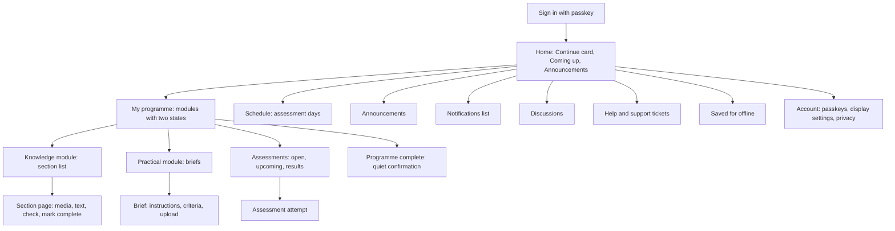
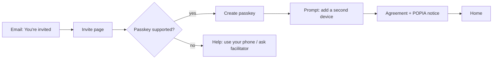
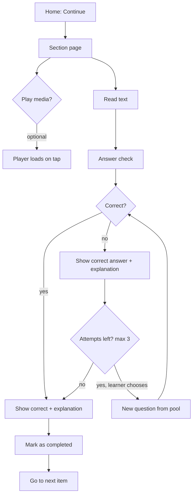

# Design brief: apps/lms

> Status: **Approved v3 (2026-11-07).** Decisions come from the design-gate Q&A recorded in the last section. Anything this brief does not cover must go back through the design gate in `CLAUDE.md` before it is built.

## 1. Principles

1. **Calm over clever.** The feel is Coursera / Khan Academy: lots of white space, one thing at a time, no decorative motion. **Never:** gamification (points, streaks, badges, leaderboards, confetti), pop-ups or nags (modals, tours or prompts that block content), or Moodle-style clutter (sidebar widgets, link dumps).
2. **Text is the lesson.** Every section must work completely as text. Audio and video are a featured extra, never a requirement.
3. **Respect the learner's data.** Nothing heavy loads until the learner asks for it, and the cost of media is shown before they tap.
4. **Phone and laptop are both first-class.** Layouts start at 360 px and widen. Nothing is phone-only or laptop-only for learners.
5. **Always know where you are and what's next.** The learner always has the breadcrumb, a checkmark outline and a single obvious "Continue".
6. **Plain, warm words.** Use a Grade 8 reading level, second person and short sentences. Formal wording appears only where compliance needs it.
7. **Learning is not the same as competence.** "I've worked through it" and "an assessor found me competent" are shown as separate states and never blurred together.
8. **Staff screens are tools.** They are dense and efficient, but use the same tokens, so the product feels like one system.

## 2. Brand alignment (from `apps/web`)

**Same family, calmer.**

| Kept from apps/web                                                                             | Changed for the LMS                                                                                                                                                                       |
| ---------------------------------------------------------------------------------------------- | ----------------------------------------------------------------------------------------------------------------------------------------------------------------------------------------- |
| GRIT Hub horizontal logo (`grithub-logo-horz*.svg`) in the header; circle logo for favicon/PWA | **GRIT red #E92938** is limited to the logo, small brand accents and large display text. It is **never** used for errors, buttons or body text (4.34:1 on white fails AA for normal text) |
| **Inter** as the single typeface                                                               | **No Playfair Display.** Headings use Inter as well, so reading pages stay quiet                                                                                                          |
| Material look (apps/web already uses MUI)                                                      | **Material Symbols, Outlined**, weight 400, as inline SVG (see §9)                                                                                                                        |
| Charcoal **#2E303B** for text; ice blues for quiet surfaces                                    | Ocean **#4C7B9A** is darkened to **#3B6680** for links and buttons (6.18:1, up from a borderline 4.56:1)                                                                                  |
|                                                                                                | Bootstrap and the leftover Proxima Nova/Didot styles are not carried over; this is a fresh token set                                                                                      |

## 3. Information architecture



**Learner primary navigation:**

- Phones: bottom bar with 4 items: **Home · Learn · Schedule · More**.
- Laptops: top bar with the same items, plus the Display menu and the account menu.
- Both: a notifications icon (in-app list of announcements, released results and deadlines). Email remains the only off-platform channel.
- **Email preferences** (Account → Notifications):
  - Always sent, cannot be turned off: invites and sign-in help, results released, assessment-day changes, deadlines.
  - Optional, on by default: announcements, discussion replies, support ticket updates. Each can be set to _instant_, _weekly digest_ or _off_.

**Staff navigation:** a left sidebar (laptop-first), grouped by role.

- Facilitator: Cohorts, Content, Announcements, Discussions, Tickets, Attendance.
- Assessor: Marking queue, Assessment days.
- Moderator: Moderation sample.
- Admin: People, Qualifications, Question banks, Blueprints, Exports, Sync status, Audit log.
- External evaluator: a read-only "Evidence" area only.

## 4. Screen inventory

### Learner

| #   | Screen                                | Notes                                                                                                                                |
| --- | ------------------------------------- | ------------------------------------------------------------------------------------------------------------------------------------ |
| L1  | Invite landing / register passkey     | Explains passkeys in one sentence and offers "Add another device"                                                                    |
| L2  | Sign in                               | One button: "Sign in with passkey". Help link for lost devices                                                                       |
| L3  | First-run: agreement and POPIA notice | Accept once; the accepted version is stored                                                                                          |
| L4  | Home                                  | Greeting with first name, Continue card, Coming up, latest announcement                                                              |
| L5  | My programme                          | Module cards with **Learning** state + **Competence** state                                                                          |
| L6  | Module overview                       | Section list with checkmarks, thin bar, "x of y sections", "Download module text (PDF)"                                              |
| L7  | Section page                          | Coursera-style item page: grouped outline + featured media → text → check card → Mark as completed → Go to next item                 |
| L8  | Practical brief                       | Instructions, criteria, assigned variant, upload, submission history                                                                 |
| L9  | Assessments list                      | Open / upcoming / done; window dates; "needs connection" note                                                                        |
| L10 | Assessment attempt                    | One question per screen on all sizes; question navigator; review before submit; autosave; server timer                               |
| L11 | Results and feedback                  | Decisions appear only when released (after the batch's moderation closes); assessor feedback                                         |
| L12 | Schedule                              | Assessment days, venue, what to bring, attendance record                                                                             |
| L13 | Announcements                         | List + detail                                                                                                                        |
| L14 | Discussions                           | Thread list per cohort/section; thread view                                                                                          |
| L15 | Help                                  | FAQ + raise/view support tickets                                                                                                     |
| L16 | Saved for offline                     | Saved sections, size used, remove                                                                                                    |
| L17 | Account                               | Passkeys (add/rename/remove), display settings, email preferences, privacy, sign out                                                 |
| L18 | Offline / error / empty states        | Shared patterns, see §8; text + icon only, no illustrations                                                                          |
| L19 | Notifications                         | In-app list; unread marker; links to the item                                                                                        |
| L20 | Programme complete                    | Quiet confirmation, next steps (external assessment), results summary download; states clearly it is not a qualification certificate |

### Staff

| #   | Screen                                                                       | Roles                          |
| --- | ---------------------------------------------------------------------------- | ------------------------------ |
| S1  | Cohort dashboard: progress table, at-risk flags, check-question struggles    | Facilitator, Admin             |
| S2  | Content editor: sections, content items, media upload, transcript (required) | Facilitator, Admin             |
| S3  | Announcement composer                                                        | Facilitator, Admin             |
| S4  | Attendance marking (works on phone)                                          | Facilitator, Admin             |
| S5  | Marking queue → split view: evidence left, criteria and decision right       | Assessor                       |
| S6  | Attempt replay: exact questions and option order with keys overlaid          | Assessor, Moderator, Evaluator |
| S7  | Moderation sample → split view with decision history                         | Moderator                      |
| S8  | People and invites, role grants                                              | Admin                          |
| S9  | Qualification / module / section structure + coverage report                 | Admin                          |
| S10 | Question banks, question versions, pool health                               | Admin                          |
| S11 | Blueprints with validation and coverage                                      | Admin                          |
| S12 | Exports (POE, results, attendance), job progress                             | Admin                          |
| S13 | Airtable sync status                                                         | Admin                          |
| S14 | Audit log                                                                    | Admin, Evaluator               |
| S15 | Evaluator evidence home (read-only)                                          | Evaluator                      |

## 5. Wireframes

### L4 Home (phone)

```
┌──────────────────────────────────┐
│ [GRIT logo]                  (A) │
│                                  │
│ Good morning, Learner            │
│ ┌──────────────────────────────┐ │
│ │ Continue                     │ │
│ │ KM-01 · Section 3: Networks  │ │
│ │ ▓▓▓▓▓░░░░░  3 of 8 sections  │ │
│ │               [ Continue → ] │ │
│ └──────────────────────────────┘ │
│ Coming up                        │
│  ▸ Assessment day · Sat 14 Nov   │
│  ▸ KM-01 formative closes 20 Nov │
│ Latest announcement           ›  │
│                                  │
├──────────────────────────────────┤
│  Home    Learn   Schedule  More  │
└──────────────────────────────────┘
```

### L7 Section page (laptop): Coursera-style item page

```
┌──────────────────────────────────────────────────────────────────┐
│ [logo]   Home  Learn  Schedule  More           🔔   Aa   (A)     │
├────────────────┬─────────────────────────────────────────────────┤
│ ◧ Hide outline │ KM-01 › Section 3 of 8                          │
│ ▾ KM-01        │ Networks                                        │
│   ✓ 1 Intro    │ ┌─────────────────────────────────────────────┐ │
│   ✓ 2 Hardware │ │      [poster ~20 KB]                         │ │
│   ● 3 Networks │ │   ▶ Watch · 6 min · ~25 MB                   │ │
│   ○ 4 Security │ └─────────────────────────────────────────────┘ │
│   ○ 5 Cloud    │ ▸ Transcript                                    │
│   ▓▓▓░░ 2 of 8 │                                                 │
│ ▸ KM-02        │ Body text in a ~68ch column, 18px base, 1.6     │
│ ▸ PM-01        │ line height ...                                 │
│                │                                                 │
│                │ ┌ Check your understanding ──────────────────┐  │
│                │ │ Question stem                              │  │
│                │ │ ○ Option   ○ Option   ○ Option             │  │
│                │ │ ○ All of the above (pinned)                │  │
│                │ │                           [Check answer]   │  │
│                │ └────────────────────────────────────────────┘  │
│                │ [ ✓ Mark as completed ]  (after answering)      │
│                │                          [ Go to next item → ]  │
└────────────────┴─────────────────────────────────────────────────┘
```

The outline is grouped by module (current module expanded, others collapsed), open by default from 900 px, and can be hidden. On phones it becomes an "Outline" button that opens a sheet, the media block goes full-bleed, and "Mark as completed" / "Go to next item" sit in a sticky bottom bar. Icons shown here as symbols are Material Symbols Outlined in the build.

### Check card states

```
Answered correctly                       Answered incorrectly (attempt 1 of 3)
┌ Check your understanding ─────────┐    ┌ Check your understanding ──────────────┐
│ ✓ Correct                         │    │ ✗ Not quite                             │
│ ● Router   ← your answer          │    │ ● Switch  ← your answer                 │
│ Explanation text...               │    │ ✓ Router  ← correct answer              │
└───────────────────────────────────┘    │ Explanation text...                     │
                                         │ [Try another question] (2 left)         │
                                         └─────────────────────────────────────────┘
```

After the third attempt, "Try another question" disappears. The status is never shown with colour alone; each state has an icon and a word.

### L10 Assessment attempt (phone and laptop)

```
┌──────────────────────────────────────────┐
│ KM-01 Formative 2     ⏱ 24:10   ✓ Saved  │
├──────────────────────────────────────────┤
│ Question 4 of 12                 ⚑ Flag  │
│                                          │
│ Question stem ...                        │
│  ○ Option                                │
│  ○ Option                                │
│  ○ Option                                │
│  ○ None of the above                     │
│                                          │
│ [← Previous]                  [Next →]   │
├──────────────────────────────────────────┤
│ 1✓ 2✓ 3✓ 4● 5○ 6⚑ 7○ 8○ 9○ 10○ 11○ 12○   │
│                       [Review & submit]  │
└──────────────────────────────────────────┘
```

### L20 Programme complete (quiet)

```
┌──────────────────────────────────────────┐
│ ✓ You've completed all modules           │
│                                          │
│ Every module in this programme has been  │
│ assessed and moderated as Competent.     │
│                                          │
│ What happens next                        │
│  • External assessment (EISA): dates and │
│    how to prepare                        │
│  • Your facilitator will contact you     │
│                                          │
│ [Download results summary (PDF)]         │
│                                          │
│ This is not a qualification certificate. │
│ Certificates are issued by the QCTO.     │
└──────────────────────────────────────────┘
```

### S5 Assessor marking (laptop, dense)

```
┌ Marking queue › Learner · PM-01 Brief B ──────────────────────────────────────┐
│ ┌ Evidence ─────────────────────────┐ ┌ Criteria and decision ─────────────────┐ │
│ │ file-1.pdf  (preview)             │ │ ☐ AC1 ...   ☐ AC2 ...  ☐ AC3 ...       │ │
│ │ photo-2.jpg                       │ │ Feedback [............................]│ │
│ │ Submitted 12 Nov · attempt 1      │ │ ( ) Competent  ( ) Not yet competent   │ │
│ │                                   │ │ [Save draft]       [Record decision]   │ │
│ └───────────────────────────────────┘ └────────────────────────────────────────┘ │
│ ← Previous in queue                                          Next in queue →    │
└─────────────────────────────────────────────────────────────────────────────────┘
```

## 6. Key flows

### First sign-in (invite)



### Studying a section



"Mark complete" is enabled once the check has been answered at least once (right or wrong).

### Resume

"Continue" always opens the last section the learner viewed, at their scroll position (saved on the server). If that section is complete, it opens the next incomplete section.

### Practical submission

Brief → choose files → **direct upload with per-file progress** (it can resume after a drop) → review list → Submit → confirmation with timestamp → status "Being assessed" → (assessor decides, moderator samples) → **all decisions for that assessment and cohort are released together when the moderator closes the sample** → notification + feedback.

### Assessment day

The learner opens Schedule → assessment day → attempt (supervised). The facilitator marks attendance on a phone (S4). Answers autosave on every change, and a banner shows "Saved" / "Offline, answers kept on this device".

## 7. States: what "done" looks like

| Level     | Learning state                                                                                 | Competence state                                                                                                                                                                               |
| --------- | ---------------------------------------------------------------------------------------------- | ---------------------------------------------------------------------------------------------------------------------------------------------------------------------------------------------- |
| Section   | ○ Not started · ● In progress · ✓ Complete (learner marked complete after answering the check) | n/a                                                                                                                                                                                            |
| Module    | "x of y sections" + thin bar → **Learning complete**                                           | Not assessed · Submitted · Being assessed · **Competent** / Not yet competent (with feedback). Results are visible **only after release**, which happens when moderation for that batch closes |
| Programme | Modules completed count                                                                        | **Programme complete** page (L20) when every module is released as Competent                                                                                                                   |

## 8. Components

**Foundations:** AppShell (learner), StaffShell (sidebar), TopBar, BottomNav, Breadcrumb, OutlineDrawer/Sheet (grouped by module), DisplayMenu (text size + theme), SkipLink, Icon (Material Symbols Outlined, inline SVG), NotificationButton + NotificationList.

**Learning:** ContinueCard, ModuleCard (two-state), SectionList, ProgressBar (thin), StatusIcon (not started / in progress / complete), RichText (prose styles), MediaFeature (poster + play + duration + size → Mux player on tap), AudioBar, TranscriptPanel, CheckCard (+ result states), MarkCompleteButton, NextItemBar, SaveOfflineButton, PdfDownloadButton, ProgrammeCompletePanel.

**Assessment:** AttemptHeader (timer, autosave status), QuestionView (single/multi), OptionList (radio/checkbox with large hit area), QuestionNavigator (answered/flagged), ReviewPage, SubmitConfirm, ResultSummary, FeedbackBlock.

**Practical:** BriefView, CriteriaList, FileUploader (direct, resumable, progress), SubmissionHistory.

**Communication:** AnnouncementItem, ThreadList, PostComposer, TicketForm.

**Feedback and system:** Banner (info/success/warning/danger), Toast (non-critical only), InlineError, EmptyState (icon + text, no illustration), OfflineBanner, Skeleton, ConfirmDialog, Badge/Tag.

**Staff:** DataTable (sort, filter, bulk select, sticky header), FilterBar, SplitView, EvidenceViewer, DecisionForm, AttemptReplay, AttendanceList, CoverageMatrix, AuditTable, JobProgress.

## 9. Tokens

### Typography (Inter only, via `next/font`, subset `latin`, variable font)

| Token       | Size / line height | Use                          |
| ----------- | ------------------ | ---------------------------- |
| `text-xs`   | 13 / 18            | Staff tables metadata only   |
| `text-sm`   | 15 / 22            | Captions, helper text        |
| `text-base` | **18 / 29 (1.6)**  | Learner reading text         |
| `text-ui`   | 16 / 24            | Learner UI, staff body       |
| `text-lg`   | 20 / 30            | Lead paragraph, card titles  |
| `text-xl`   | 24 / 32            | H3 / section titles on phone |
| `text-2xl`  | 30 / 38            | H2 / page title on phone     |
| `text-3xl`  | 36 / 44            | Page title on laptop         |

- Weights: 400 body, 600 headings/buttons. No italic for long passages.
- Reading measure: max **68ch**.
- Display menu text sizes: **S 16 · M 18 (default) · L 20 · XL 22** for reading text. The UI scales with it via `rem`. The choice is stored per user.

### Iconography and imagery

- **Material Symbols, Outlined style**, weight 400, grade 0, optical size 20/24. Imported per icon as inline SVG components (no icon font), so only the icons used are shipped.
- Icons sit alongside text labels; an icon alone is used only for universally understood actions (close, menu, notifications) and always has an accessible name.
- Icons use `currentColor`, so they follow text/accent tokens in both themes.
- **No imagery** on the learner side: no illustrations or photos, including empty states and the completion page. Content authors may still include diagrams and images inside lesson text.

### Spacing, radius, elevation

- Spacing scale (4-pt): 4, 8, 12, 16, 24, 32, 48, 64. Learner pages use 24–48 between blocks; staff pages use 8–16.
- Radius: 6 (inputs), 10 (cards), 999 (pills).
- Elevation: borders first, with one subtle shadow level for overlays only.
- Breakpoints: 360 (base), 600, 900 (outline drawer becomes inline), 1200.

### Colour (contrast measured against the page background)

| Token                                    | Light                       | Dark             | Notes                                                                  |
| ---------------------------------------- | --------------------------- | ---------------- | ---------------------------------------------------------------------- |
| `bg`                                     | #FFFFFF                     | #15161B          |                                                                        |
| `surface`                                | #FFFFFF                     | #1E2028          | cards                                                                  |
| `surface-sunken`                         | #F0F4F7 (ice50)             | #121318          | outline, check card                                                    |
| `text`                                   | #2E303B (charcoal) · 13.1:1 | #E8E9EE · 14.9:1 |                                                                        |
| `text-muted`                             | #5A5D6B · 6.5:1             | #A6A9B6 · 7.7:1  |                                                                        |
| `border`                                 | #8A8E9C · 3.3:1 (non-text)  | #6B6F7D · 3.6:1  | input borders; hairlines may be lighter                                |
| `accent` (links, primary buttons, focus) | #3B6680 · 6.2:1             | #8CB8D4 · 8.5:1  | darkened ocean                                                         |
| `on-accent`                              | #FFFFFF · 6.2:1             | #15161B · 8.5:1  | button text                                                            |
| `brand`                                  | #E92938                     | #F0505D · 5.2:1  | logo/accents only; light value 4.34:1, so large text and non-text only |
| `success`                                | #3F7A1F · 5.2:1             | #8DC26A · 8.7:1  | always with ✓ icon + word                                              |
| `danger`                                 | #B42318 · 6.6:1             | #F08A80 · 7.4:1  | always with ✗/! icon + word                                            |
| `warning`                                | #8A5A00 · 5.9:1             | #E0B04A · 9.0:1  |                                                                        |
| `focus-ring`                             | 2 px `accent` + 2 px offset | same             |                                                                        |

Themes: Light / Dark / **System (default)** in the Display menu, stored per user. **MVP: learner screens only.** Staff screens are light-only at first; they use the same tokens so dark mode can follow later. Tokens are CSS custom properties; components never use raw hex.

## 10. Accessibility rules (WCAG 2.2 AA)

- Contrast: text 4.5:1 minimum (the tokens above reach 5.2:1+), UI components and boundaries 3:1.
- Fully keyboard operable. Visible focus everywhere, and focus is never obscured by sticky bars (2.4.11).
- Target size at least 24×24 CSS px (2.5.8); learner controls aim for 44×44.
- Status is never shown by colour alone (icon + text).
- Semantic headings (one H1 per page), landmarks, a skip link, and a correct `lang` attribute.
- Check feedback and autosave status use `aria-live="polite"`. Assessment timers announce only at set intervals.
- Every video has captions; every audio/video item has a transcript (it cannot be published without one).
- Layouts reflow at 320 px and 400% zoom without horizontal scroll (except data tables).
- Respect `prefers-reduced-motion`. There is no autoplay anywhere.
- Timed assessments: show the remaining time and support extra-time accommodations set by staff (2.2.1).
- Authentication: the passkey flow needs no cognitive test (3.3.8).
- Forms: labels always visible, errors stated in text next to the field and summarised at the top.
- Testing: axe in CI plus manual NVDA/TalkBack and VoiceOver passes on key flows each release.

## 11. Low-data rules

- **Budget:** the learner section page should be **≤ 150 KB transferred** (HTML+CSS+JS+fonts, excluding media) on first load, and **≤ 30 KB** on later section navigation.
- No media bytes or player script before a tap. The poster is ≤ 20 KB (AVIF/WebP). Audio-only items show a slim bar with no poster.
- Always show the duration and **estimated data size** before playback. Quality is **adaptive only** (the player picks the rendition from connection speed); there is no manual quality menu.
- One variable Inter font file, subset, `font-display: swap`.
- Images in content are responsive (`srcset`), lazy-loaded and compressed. Admins are warned when an upload exceeds a set size.
- No third-party scripts on learner pages (no analytics beyond what consent allows, and no chat widgets).
- Server-rendered pages that work before JS hydrates, with progressive enhancement for checks and autosave.
- **Save for offline:** saves a section's text, images and (opt-in) audio through a service worker. Check answers made offline queue up and sync. Assessments always need a connection.
- Admins are warned when an uploaded content image is over 300 KB or a poster is over 20 KB.
- Icons are inline SVG (a few hundred bytes each), never an icon font.
- **Module PDF download** is generated on the server and cached per content version; the button shows the file size before download.

## 12. Staff screen rules

- Laptop-first. **Tablet landscape (from ~900 px) supports marking and moderation**: the split view stays side by side. Below that, panels stack and become read-only. Phones get read-only views plus **attendance marking**, which is fully phone-friendly.
- Same tokens, compact spacing scale, `text-ui`/`text-xs`. Light theme only in the MVP.
- Tables: sortable, filterable, bulk actions, sticky header, filters saved in the URL.
- Split views for marking and moderation, with keyboard shortcuts for next/previous.
- Moderators have a **Close sample and release results** action per assessment and cohort; it shows how many learners will be notified before confirming.
- Destructive or irreversible actions (record decision, moderate, revoke passkey) need a confirmation that states what changes.
- The evaluator sees the same screens, read-only, with a persistent "Read-only evaluator access, expires dd MMM" banner.

## 13. Still undecided

Nothing is undecided in the design itself. One input is still pending:

- **Copy guide (owned by GRIT Hub).** Someone at GRIT Hub will write the wording for empty states, errors, offline messages, confirmations and success messages. The LMS will use their text as written. Until it arrives, placeholder strings are marked `TODO(copy)` and must follow §1 principle 6 (warm, plain, Grade 8, second person).

## 14. Design-gate record

| Date       | Area          | Question                       | Answer                                                                                                                                                |
| ---------- | ------------- | ------------------------------ | ----------------------------------------------------------------------------------------------------------------------------------------------------- |
| 2026-11-07 | Brand         | How closely to match apps/web? | Same family, calmer: keep logo, Inter, charcoal/ocean/ice; red as a small accent; no Playfair                                                         |
| 2026-11-07 | Tone          | Voice for learner-facing text  | Warm and plain                                                                                                                                        |
| 2026-11-07 | Learners      | Main devices                   | Mix of phone and laptop                                                                                                                               |
| 2026-11-07 | Learners      | Data/connectivity              | Mixed: some Wi-Fi, some mobile data                                                                                                                   |
| 2026-11-07 | Learners      | Reading level                  | Plain language, ~Grade 8                                                                                                                              |
| 2026-11-07 | Learners      | Languages                      | English now; i18n layer so more can be added later                                                                                                    |
| 2026-11-07 | Learning page | Layout                         | Single column + collapsible outline                                                                                                                   |
| 2026-11-07 | Learning page | Progress                       | Checkmarks + thin bar, "x of y sections"                                                                                                              |
| 2026-11-07 | Learning page | Media placement                | Featured player at top                                                                                                                                |
| 2026-11-07 | Learning page | Before play                    | Tiny poster + duration + data size; no player script until tap                                                                                        |
| 2026-11-07 | Learning page | Transcripts                    | Always, collapsed by default (+ captions)                                                                                                             |
| 2026-11-07 | Learning page | Text size                      | A−/A+ control, remembered per user                                                                                                                    |
| 2026-11-07 | Section check | Presentation                   | Inline card at the end of the section                                                                                                                 |
| 2026-11-07 | Section check | Feedback                       | Reveal correct answer (+ explanation)                                                                                                                 |
| 2026-11-07 | Section check | Retries                        | First attempt + 2 retries (3 max), fresh question each time                                                                                           |
| 2026-11-07 | Section check | Gating                         | Must answer, need not pass                                                                                                                            |
| 2026-11-07 | Navigation    | After login                    | "Continue" card + Coming up                                                                                                                           |
| 2026-11-07 | Navigation    | Section done                   | Learner marks complete (after answering the check)                                                                                                    |
| 2026-11-07 | Navigation    | Module/programme done          | Two separate states: learning complete vs competent                                                                                                   |
| 2026-11-07 | Theme         | Dark mode                      | Follow system + manual toggle                                                                                                                         |
| 2026-11-07 | Accessibility | Target                         | WCAG 2.2 AA                                                                                                                                           |
| 2026-11-07 | Offline       | Offline content                | Save section for offline reading; assessments online only                                                                                             |
| 2026-11-07 | Staff UI      | Density                        | Dense, laptop-first, same tokens                                                                                                                      |
| 2026-11-07 | References    | Learning page reference        | Coursera-style item page (grouped outline, Mark as completed, Go to next item)                                                                        |
| 2026-11-07 | References    | Home reference                 | Single "Continue" focus                                                                                                                               |
| 2026-11-07 | References    | Dislikes                       | Pop-ups and nags; cluttered Moodle-style blocks; gamification                                                                                         |
| 2026-11-07 | Icons         | Delivery and style             | Material Symbols, Outlined, as inline SVG                                                                                                             |
| 2026-11-07 | Results       | When learners see "Competent"  | Only after moderation: results released per batch when the moderator closes the sample                                                                |
| 2026-11-07 | Imagery       | Illustrations/photos           | No imagery at all on the learner side                                                                                                                 |
| 2026-11-07 | Completion    | Programme complete             | Quiet confirmation page; not a certificate                                                                                                            |
| 2026-11-07 | Assessment    | Attempt layout                 | One question per screen + navigator, all sizes                                                                                                        |
| 2026-11-07 | Notifications | Beyond email                   | In-app notification list only                                                                                                                         |
| 2026-11-07 | Extras        | Chosen                         | Module text as PDF download; greeting with first name                                                                                                 |
| 2026-11-07 | Extras        | Not chosen                     | Staff dark mode in MVP; Data saver switch                                                                                                             |
| 2026-11-07 | Low data      | Video quality                  | Adaptive only, no manual quality menu; page budgets as in §11                                                                                         |
| 2026-11-07 | Notifications | Email preferences              | Essential always on; announcements, discussions and tickets optional (instant, weekly digest or off)                                                  |
| 2026-11-07 | Copy          | Empty-state and error wording  | Written by someone at GRIT Hub; LMS uses their text                                                                                                   |
| 2026-11-07 | Staff UI      | Tablet marking                 | Yes, tablet landscape supported; smaller screens read-only                                                                                            |
| 2026-11-07 | Approval      | Design brief status            | v3 approved                                                                                                                                           |
| 2026-11-07 | Navigation    | URL structure                  | Learner at `/` (route group `(learn)`: `/`, `/learn`, `/schedule` …); staff under `/staff/…`; admin under `/admin/…`                                  |
| 2026-11-07 | Placeholder   | Home before auth/data          | Minimal holding page: logo, "GRIT Hub Learning", one line; tokens only; copy is `TODO(copy)`                                                          |
| 2026-11-07 | Components    | packages/ui reuse              | Wire up only; render no packages/ui components until they are restyled with the LMS tokens                                                            |
| 2026-11-07 | Sign-in       | Layout                         | Email field (passkey autofill) + primary "Sign in with passkey"; quieter "Email me a sign-in link"; "Lost access? Get help"                           |
| 2026-11-07 | Setup         | First-time setup layout        | One step per screen with "Step x of 3": details → POPIA notice and consent → passkey                                                                  |
| 2026-11-07 | Setup         | Learner may skip passkey       | Yes, "Skip for now"; gentle reminder on Home. Staff who need step-up can't skip                                                                       |
| 2026-11-07 | Admin         | CSV import                     | Validate → preview table with per-row status → confirm; only valid rows imported                                                                      |
| 2026-11-07 | Admin         | People screen                  | One table + status filter chips (All · Invited · Active · Expired invite · Deactivated); row actions in a "⋯" menu; Invite / Import buttons top right |
