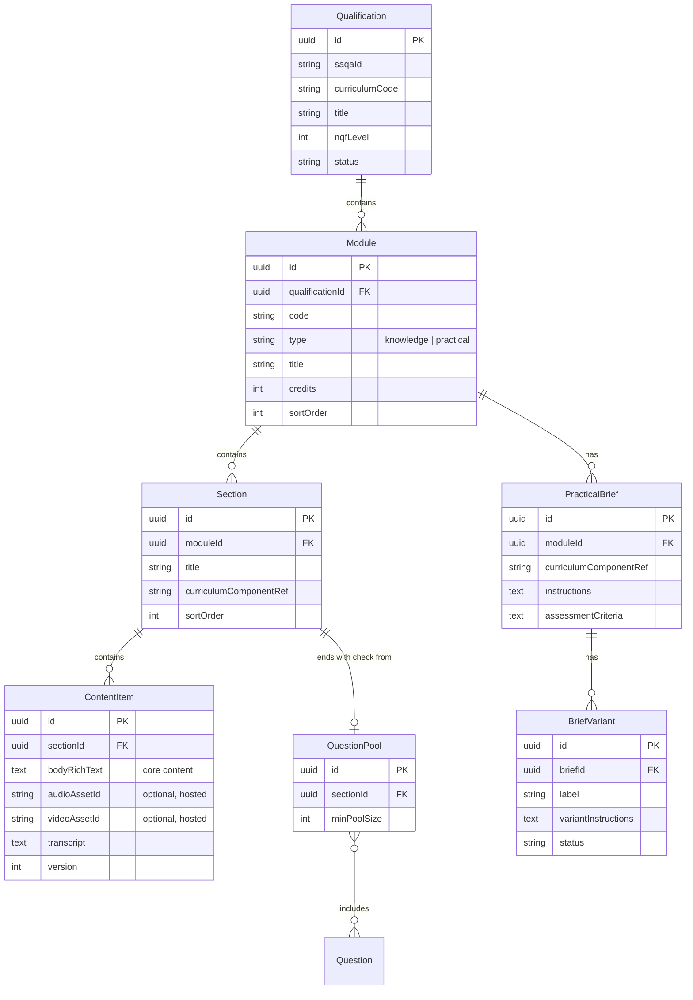
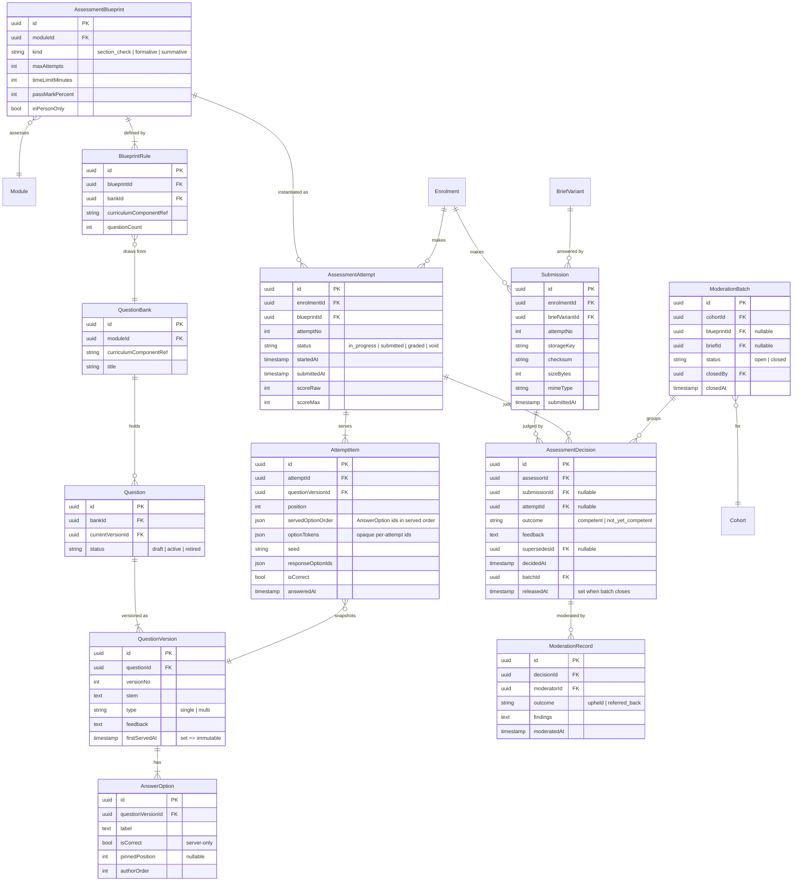
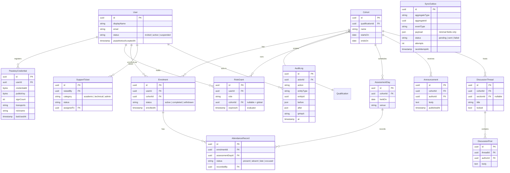

# Domain model (proposed)

Conventions: every table has `id` (UUID), `createdAt` and `updatedAt`. Soft-delete (`archivedAt`) is used where records feed the POE; assessment evidence is never hard-deleted. Field lists below are indicative, not final schema.

## Structure and content

## Question banks and assessment

## People, cohorts and operations

## Rules the schema must enforce

- **QuestionVersion is immutable once used.** When `firstServedAt` is set, edits are rejected (DB trigger + application check). Editing a question creates a new version and moves `Question.currentVersionId`. Old attempts keep pointing at the version they served.
- **AttemptItem is a snapshot.** It stores the exact `questionVersionId`, the served option order and the seed, so a moderator or appeal panel can see exactly what the learner saw.
- **Module.type** is limited to `knowledge | practical`. A workplace value is deliberately not allowed.
- **Results are released per batch.** Closing a `ModerationBatch` sets `releasedAt` on all its decisions in one transaction. Learners can read a decision only when `releasedAt` is set.
- **Decisions are append-only.** A change creates a new `AssessmentDecision` with `supersedesId`. Decisions with a `ModerationRecord` are locked.
- **AuditLog is append-only** (no UPDATE/DELETE grants for the app role).
- **SyncOutbox** rows are written in the same transaction as the domain change they describe.
- **Submission files** live in object storage. The DB holds only `storageKey`, checksum and metadata.
- Added helper entities not in the original list: `BlueprintRule`, `RoleGrant`, `AssessmentDay`, `DiscussionPost`, `User`. These are needed to express the rules above.
