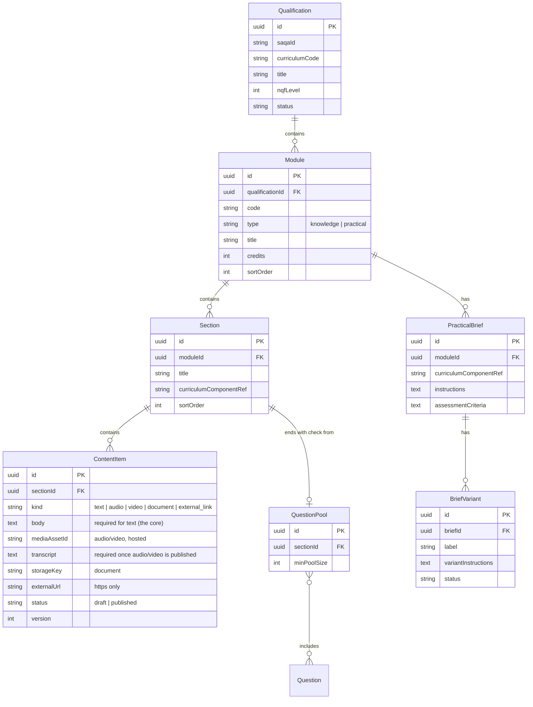
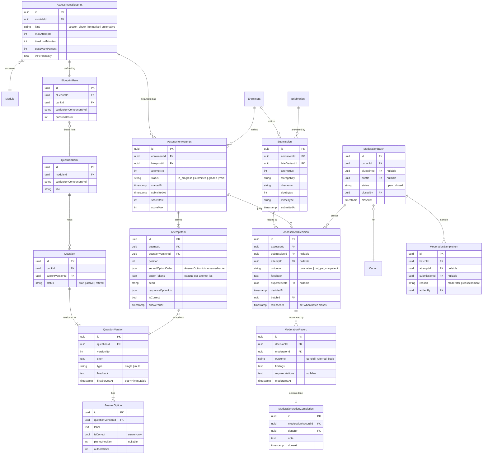
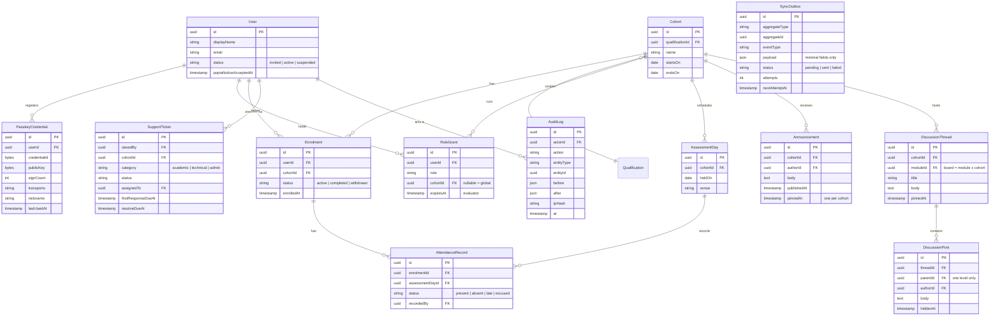

# Domain model (proposed)

Conventions: every table has `id` (UUID), `createdAt` and `updatedAt`. Soft-delete (`archivedAt`) is used where records feed the POE; assessment evidence is never hard-deleted. Field lists below are indicative, not final schema.

## Structure and content

## Question banks and assessment

### Added with moderation (2026-11-08, ADR-015)

- **Cohort** gains `moderationRatePercent` (1–100, default 25): the minimum share of each batch to sample.
- **ModerationSampleItem**: one learner's work (attempt or submission) in a batch's sample, keyed by the work so a re-decided decision stays sampled. Reason `reassessment` for appeal reassessments (added automatically, never removed).
- **ModerationRecord** gains `requiredActions`. Verdicts: Agree = upheld; Agree with actions = upheld + actions; Disagree = referred_back. One per decision version.
- **ModerationActionCompletion**: the assessor's "Actions done" note (append-only). **ModerationFeedbackRead**: when an assessor last opened Moderation feedback (sidebar badge).
- **RoleGrant**: assessor grants always name a cohort, one per cohort.

### Added with the assessment engine (2026-11-08)

- **AssessmentSchedule**: when a cohort may write a blueprint: a window (formative) or an assessment day (summative). Reassessment = another schedule.
- **PaperUnlock**: an assessor opened one learner's summative paper on the day (append-only); used once by the attempt.
- **RegisterSignoff**: the assessor's sign-off of an assessment day's register; attendance (with `idVerifiedAt/By`) is final after it.
- **RubricCriterion**: mark range per criterion for a short-answer QuestionVersion (frozen with the version). **ItemMark**: marks per criterion for one AttemptItem.
- **DecisionDraft**: an assessor's unsaved decision; recording creates an immutable AssessmentDecision.
- **Appeal**: a learner's appeal against a released decision; a moderator upholds it or orders a reassessment (one extra attempt).
- AssessmentBlueprint gains `status` (draft/published), `showAnswers`; AssessmentAttempt gains `scheduleId`, `unlockId`, `deadlineAt`, `extraMinutes`, `pausedAt`, `autoSubmitted`, `usedFallback`; AttemptItem gains `responseText`, `flagged`, `marksAwarded`, `markerNote`; QuestionVersion gains `maxMarks` and type `short_answer`.

### Added with practical assessments (2026-11-08)

- **PracticalBrief** gains `mode` (submission / observed), `maxAttempts`, `status` (draft / published). **BriefCriterion**: Met / Not yet met criteria shared by every variant.
- **Submission** is now one practical attempt: seeded, stored `briefVariantId` + `seed`, `attemptNo`, `status` (draft / submitted), `observed`, `observationNotes`, `linksConfirmed`, `scheduleId`.
- **EvidenceItem**: a private file (Blob pathname, size, type, SHA-256, scan status) or an allow-listed https link; source learner or assessor.
- **CriterionJudgement**: Met / Not yet met + comment per criterion. **PracticalDecisionDraft**: unsaved decision.
- **AssessmentSchedule** now targets a blueprint or a brief.
- New tables carry a nullable `tenant_id` (tenancy readiness).

### Added for QCTO data (2026-11-08)

See [compliance/qcto-leisa-mapping.md](compliance/qcto-leisa-mapping.md) and ADR-014.

- **LearnerQctoProfile** (one per learner per tenant): name as on ID, title, codes (gender, nationality, home language, citizen, socioeconomic and immigrant status, province, Stats SA area), `shareEmailWithQcto`; **encrypted**: national / alternate ID (with blind-index hashes), birth date, equity, disability status and rating, home and postal address, phone, cell, fax.
- **EnrolmentQctoRecord** (one per enrolment): readiness type, SOR status and issue date, FLC code and statement number, expected completion date, SDP code override (AP-led RPL).
- **ProviderAccreditation** and **QualificationAccreditation**: SDP code, accreditation number, legal name, start and end dates.
- **AssessmentCentre**; **Cohort** gains `eisaOn` and `assessmentCentreId`.
- **QctoSubmissionBatch** (a LEISA file: purpose, status, file name, storage key, SHA-256, row count, who and when) and **QctoSubmissionItem** (enrolment, row number, row hash, QCTO outcome).
- **ConsentRecord** gains `kind` (`popia_notice` / `qcto_sharing`) and `granted`.
- GLOBAL reference tables (no tenant): the QCTO code lists and `statssa_area_codes` (`packages/db/src/tenancy.ts`).

### Added with communication and support (2026-11-08, ADR-016)

- **Announcement** gains `pinnedAt` (at most one per cohort). **DiscussionThread** is now per module and cohort (`moduleId`, opening `body`, `pinnedAt`; `sectionId` and `locked` dropped). **DiscussionPost** gains `parentId` (one level, trigger-enforced), `editedAt`, `hiddenAt`/`hiddenBy`; posts are never deleted.
- **Conversation** (cohort, learner, one facilitator or the assessor; read markers per side) and **DirectMessage** (`editedAt`, `hiddenAt`). **MessageRevision**: append-only earlier text of an edited post or message.
- **ContentReport**: a learner's report of a post or message (reason, note, open / hidden / dismissed, reviewer).
- **SupportTicket** gains `cohortId`, first-reply and resolve targets (working hours), `firstRespondedAt`, `resolvedAt`, `closedAt`, `lastActivityAt`; **TicketReply**.
- **Notification** (the bell; also drives instant and digest email) and **EmailPreference** (instant / digest / off for announcements, discussions, messages, tickets).
- **SectionNote**: a facilitator note and optional recording link on a section, for one cohort.
- **LiveSession** (cohort, optional module, Zoom link, start/end, recording link, `cancelledAt`, `sequence` for calendar updates) and **SessionAttendance** (present / late / absent / excused).
- **JobRun**: claims one run of a scheduled job (weekly digest, overdue-ticket email).
- At-risk flags are computed on read (no table). Every new table carries a nullable `tenant_id`; uniqueness rules include the tenant key.

## People, cohorts and operations

## Rules the schema must enforce

- **QuestionVersion is immutable once used.** When `firstServedAt` is set, edits are rejected (DB trigger + application check). Editing a question creates a new version and moves `Question.currentVersionId`. Old attempts keep pointing at the version they served.
- **AttemptItem is a snapshot.** It stores the exact `questionVersionId`, the served option order and the seed, so a moderator or appeal panel can see exactly what the learner saw.
- **Module.type** is limited to `knowledge | practical`. A workplace value is deliberately not allowed.
- **Results are released per batch.** Closing a `ModerationBatch` sets `releasedAt` on all its decisions in one transaction. Learners can read a decision only when `releasedAt` is set.
- **Decisions are append-only.** A change creates a new `AssessmentDecision` with `supersedesId`. Decisions with a `ModerationRecord` are locked.
- **AuditLog is append-only** (no UPDATE/DELETE grants for the app role).
- **SyncOutbox** rows are written in the same transaction as the domain change they describe.
- **Submission files** live in object storage. The DB holds only `storageKey`, checksum and metadata.
- Added helper entities not in the original list: `BlueprintRule`, `RoleGrant`, `AssessmentDay`, `DiscussionPost`, `User`. These are needed to express the rules above.
